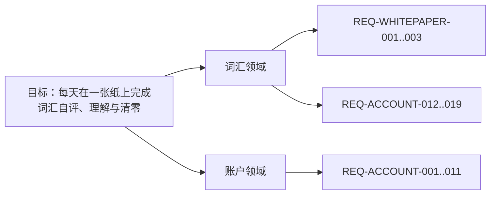

# 目标树（需求真源）

一份文档说清要什么、做到哪。开头是介绍与边界，中间是图，下面是逐级的文字金字塔。

## 这份文档只能由人写

GOAL 不交给 AI 生成。AI 可以和人对齐、提问、检查、把话整理清楚，但不能替人决定目标、领域、规则和验收。

理由：这份文档是人和 AI 之间的契约，契约的条款必须由人确认。AI 的职责只有两件：读它，把测试结果和证据写回对应 AC。

## 一、这份文档是什么

整套文档的唯一入口，也是人和 Agent 之间的接口。

它管目标、领域、REQ、AC 和测试用例；不管系统长什么样（[设计事实](designs/)），也不管怎么写（[工程标准](standards/)）。

| 编号 | 术语 | 定义 |
| --- | --- | --- |
| TERM-SHEET | 白纸 | 一轮学习所用的 A4 词纸 |
| TERM-ASSOC | 关联辅助 | 一个目标词 + 8 个外围词 + 8 句英文 |
| TERM-CURSOR | 学习游标 | 当前轮次停在第几个词，九宫格与关联辅助共用 |

**当前不覆盖**：

```text
1. 移动端原生 App
2. 写作/语法评分
3. 长期复习算法
4. 多人协作
```

## 二、金字塔（图）



## 三、金字塔（文字）

<!-- goal-summary -->
合计 31 条：已验证 31
<!-- /goal-summary -->

- **目标**：让一个人每天在一张纸上完成词汇自评、理解与清零。

  - **词汇领域**（核心子域）
    - 事件链：打开词书 → 扫词 → 判定 → 关联 → 清零
    - 聚合：词卡、轮次、关联网络（词卡属于词书；轮次属于当天）
    - 边界：管词汇学习、判定与关联；不管写作评分、语法课程、长期复习算法
    - 为什么这样切：词卡、轮次和关联共享同一学习事件链；写作/语法是独立产出，混入会让判定和内容生成互相污染
    - 术语：词卡 = 一个唯一词头；关联辅助 = 1 个目标词 + 8 个外围词 + 8 句英文
    - **REQ-WHITEPAPER-001 用户拥有自己的输入、判断、原文和确认后的成果；基础内容可编辑、可导出，AI 辅助不能替用户宣布掌握。**
      - 来源事件：打开词书 → 扫词 → 判定 → 关联 → 清零
      - 规则：用户拥有自己的输入、判断、原文和确认后的成果；基础内容可编辑、可导出，AI 辅助不能替用户宣布掌握。
      - AC-WHITEPAPER-001（REQ-WHITEPAPER-001）：Given 用户形成词表、原文或总结，When 编辑、保存或导出，Then 用户原始内容和确认后的版本可找回，辅助内容不会覆盖原文。
        - **测试用例**：用户形成词表、原文或总结，When 编辑、保存或导出，Then 用户原始内容和确认后的版本可找回 ｜ **状态**：已验证 ｜ [用例](others/test-cases/vocabulary.md) · [tests](../tests/contracts/product-goal.test.ts) · [查看](others/evidence/goal-runs/2026-11-08-21-49.txt)
    - **REQ-WHITEPAPER-002 页面遵循纸张、黑字、留白、低干扰和窄屏可读性；任何颜色状态都有文字、名称或其他可访问表达。**
      - 来源事件：打开词书 → 扫词 → 判定 → 关联 → 清零
      - 规则：页面遵循纸张、黑字、留白、低干扰和窄屏可读性；任何颜色状态都有文字、名称或其他可访问表达。
      - AC-WHITEPAPER-002（REQ-WHITEPAPER-002）：Given 桌面或窄屏学习路径，When 用户完成一次判断，Then 文字可读、控件可达、会/不会状态不只依赖颜色。
        - **测试用例**：桌面或窄屏学习路径，When 用户完成一次判断，Then 文字可读、控件可达、会/不会状态不只依 ｜ **状态**：已验证 ｜ [用例](others/test-cases/vocabulary.md) · [tests](../tests/contracts/product-goal.test.ts) · [查看](others/evidence/goal-runs/2026-11-08-21-49.txt)
    - **REQ-WHITEPAPER-003 本阶段不自动开通付费、云服务、教材分发或外部模型；需要这些能力时另立规格、权限、成本和验收。**
      - 来源事件：打开词书 → 扫词 → 判定 → 关联 → 清零
      - 规则：本阶段不自动开通付费、云服务、教材分发或外部模型；需要这些能力时另立规格、权限、成本和验收。
      - AC-WHITEPAPER-003（REQ-WHITEPAPER-003）：Given 当前阶段未接入付费、云服务或外部模型，When 核对页面和运行配置，Then 不出现虚假的商业能力或已完成的 AI 结果。
        - **测试用例**：当前阶段未接入付费、云服务或外部模型，When 核对页面和运行配置，Then 不出现虚假的商业能 ｜ **状态**：已验证 ｜ [用例](others/test-cases/vocabulary.md) · [tests](../tests/contracts/product-goal.test.ts) · [查看](others/evidence/goal-runs/2026-11-08-21-49.txt)
    - **REQ-ACCOUNT-012 点击词条或关联句时播放美式发音；优先本地神经语音，模型未就绪或不可用时用系统最佳英文语音兜底；不提供手动音色选择。**
      - 来源事件：打开词书 → 扫词 → 判定 → 关联 → 清零
      - 规则：点击词条或关联句时播放美式发音；优先本地神经语音，模型未就绪或不可用时用系统最佳英文语音兜底；不提供手动音色选择。
      - AC-ACCOUNT-012（REQ-ACCOUNT-012）：Given 词汇白纸已打开，When 点击一个词条，Then 以 en-US 调用系统语音播放该词。
        - **测试用例**：词汇白纸已打开，When 点击一个词条，Then 以 en-US 调用系统语音播放该词。 ｜ **状态**：已验证 ｜ [用例](others/test-cases/vocabulary.md) · [tests](../tests/e2e/pronunciation.spec.ts) · [查看](others/evidence/AC-ACCOUNT-012/2026-11-09.png)
    - **REQ-ACCOUNT-013 关联辅助按目标词返回 8 条真实短句，句子同时包含目标词和外围词。**
      - 来源事件：打开词书 → 扫词 → 判定 → 关联 → 清零
      - 规则：关联辅助按目标词返回 8 条真实短句，句子同时包含目标词和外围词。
      - AC-ACCOUNT-013（REQ-ACCOUNT-013）：Given 关联数据里存在 lesson，When 请求关联接口，Then 返回 lesson 的 8 条句子，每条包含 lesson。
        - **测试用例**：关联数据里存在 lesson，When 请求关联接口，Then 返回 lesson 的 8 条句 ｜ **状态**：已验证 ｜ [用例](others/test-cases/vocabulary.md) · [tests](../tests/e2e/associations.spec.ts) · [查看](others/evidence/AC-ACCOUNT-013/2026-11-09.png)
    - **REQ-ACCOUNT-014 九宫格扫词与关联辅助共用同一学习游标。切换视图不重置位置；任一视图推进后，另一视图从同一位置继续，不重复已过词。**
      - 来源事件：打开词书 → 扫词 → 判定 → 关联 → 清零
      - 规则：九宫格扫词与关联辅助共用同一学习游标。切换视图不重置位置；任一视图推进后，另一视图从同一位置继续，不重复已过词。
      - AC-ACCOUNT-014（REQ-ACCOUNT-014）：Given 九宫格已推进到第 73 个词，When 切到关联辅助，Then 显示第 73 个词；When 在关联辅助推进一词再切回九宫格，Then 从第 74 个词继续，不回到第 1 个。
        - **测试用例**：九宫格已推进到第 73 个词，When 切到关联辅助，Then 显示第 73 个词；When 在 ｜ **状态**：已验证 ｜ [用例](others/test-cases/vocabulary.md) · [tests](../tests/e2e/associations.spec.ts) · [查看](others/evidence/AC-ACCOUNT-014/2026-11-09.png)
    - **REQ-ACCOUNT-015 关联辅助按当前 36 词批量预取并缓存；进入只发一次批量请求，连续换词不再逐词请求；加载中保留目标词和骨架。**
      - 来源事件：打开词书 → 扫词 → 判定 → 关联 → 清零
      - 规则：关联辅助按当前 36 词批量预取并缓存；进入只发一次批量请求，连续换词不再逐词请求；加载中保留目标词和骨架。
      - AC-ACCOUNT-015（REQ-ACCOUNT-015）：Given 打开关联辅助，When 当前批次加载完成，Then 只请求一次批量接口；连续点 5 次“下一词”不再发关联请求，8 个节点保持可见。
        - **测试用例**：打开关联辅助，When 当前批次加载完成，Then 只请求一次批量接口；连续点 5 次“下一词” ｜ **状态**：已验证 ｜ [用例](others/test-cases/vocabulary.md) · [tests](../tests/e2e/vocabulary-polish.spec.ts) · [查看](others/evidence/AC-ACCOUNT-015/2026-11-09.png)
    - **REQ-ACCOUNT-016 关联辅助的 8 个外围句子可点击朗读整句；目标词点击朗读单词并按当前模式判定。**
      - 来源事件：打开词书 → 扫词 → 判定 → 关联 → 清零
      - 规则：关联辅助的 8 个外围句子可点击朗读整句；目标词点击朗读单词并按当前模式判定。
      - AC-ACCOUNT-016（REQ-ACCOUNT-016）：Given 关联辅助显示 8 条句子，When 点击任一句子节点，Then 朗读该节点整句，文本与节点句子一致。
        - **测试用例**：关联辅助显示 8 条句子，When 点击任一句子节点，Then 朗读该节点整句，文本与节点句子一 ｜ **状态**：已验证 ｜ [用例](others/test-cases/vocabulary.md) · [tests](../tests/e2e/vocabulary-polish.spec.ts) · [查看](others/evidence/AC-ACCOUNT-016/2026-11-09.png)
    - **REQ-ACCOUNT-017 登录与设置使用白纸视觉；顶部不提供“剪到另一张纸”。**
      - 来源事件：打开词书 → 扫词 → 判定 → 关联 → 清零
      - 规则：登录与设置使用白纸视觉；顶部不提供“剪到另一张纸”。
      - AC-ACCOUNT-017（REQ-ACCOUNT-017）：Given 本地神经语音未加载完成或不可用，When 点击词条或句子，Then 用系统英文语音朗读；设置里没有手动音色选择。
        - **测试用例**：本地神经语音未加载完成或不可用，When 点击词条或句子，Then 用系统英文语音朗读；设置里没 ｜ **状态**：已验证 ｜ [用例](others/test-cases/vocabulary.md) · [tests](../tests/e2e/vocabulary-polish.spec.ts) · [查看](others/evidence/AC-ACCOUNT-017/2026-11-09.png)
    - **REQ-ACCOUNT-018 重置今天在设置面板内二次确认；确认后关闭面板、回到第 1 页并显示清零提示。**
      - 来源事件：打开词书 → 扫词 → 判定 → 关联 → 清零
      - 规则：重置今天在设置面板内二次确认；确认后关闭面板、回到第 1 页并显示清零提示。
      - AC-ACCOUNT-018（REQ-ACCOUNT-018）：Given 设置里点“重置今天这本书”，When 在面板内确认，Then 面板关闭、页面回到第 1 页并显示“今日进度已清零”。
        - **测试用例**：设置里点“重置今天这本书”，When 在面板内确认，Then 面板关闭、页面回到第 1 页并显示 ｜ **状态**：已验证 ｜ [用例](others/test-cases/vocabulary.md) · [tests](../tests/e2e/vocabulary-polish.spec.ts) · [查看](others/evidence/AC-ACCOUNT-018/2026-11-09.png)
    - **REQ-ACCOUNT-019 背单词、写作、学语法切换时，顶部三个 tab 的位置不因当前模块可用操作变化而移动。**
      - 来源事件：打开词书 → 扫词 → 判定 → 关联 → 清零
      - 规则：背单词、写作、学语法切换时，顶部三个 tab 的位置不因当前模块可用操作变化而移动。
      - AC-ACCOUNT-019（REQ-ACCOUNT-019）：Given 顶部导航，When 依次切换背单词、写作、学语法，Then 没有“剪到另一张纸”入口，三个 tab 的横向位置保持一致。
        - **测试用例**：顶部导航，When 依次切换背单词、写作、学语法，Then 没有“剪到另一张纸”入口，三个 ta ｜ **状态**：已验证 ｜ [用例](others/test-cases/vocabulary.md) · [tests](../tests/e2e/vocabulary-polish.spec.ts) · [查看](others/evidence/AC-ACCOUNT-019/2026-11-09.png)
  - **账户领域**（支撑子域）
    - 事件链：注册 → 登录 → 保存判定 → 恢复进度 → 重置今天
    - 聚合：账号、词状态、每日会话（词状态属于账号与当天）
    - 边界：管身份、归属、按天保存；不管团队、权限分级、跨设备冲突合并
    - 为什么这样切：账号与学习数据共享归属和恢复生命周期；合并进词汇领域会让权限校验和扫词交互互相污染
    - 术语：词状态 = 某天某词的会/不会；每日会话 = 当天的轮次与游标
    - **REQ-ACCOUNT-001 学习状态接口只接受 session 身份。未登录访问返回 401；客户端传入的用户标识不能改变身份。账号数据的持久化和双账号隔离在独立 Plan 中定义规格与验收。**
      - 来源事件：注册 → 登录 → 保存判定 → 恢复进度 → 重置今天
      - 规则：学习状态接口只接受 session 身份。未登录访问返回 401；客户端传入的用户标识不能改变身份。账号数据的持久化和双账号隔离在独立 Plan 中定义规格与验收。
      - AC-ACCOUNT-001（REQ-ACCOUNT-001）：未登录用户看不到任何账号数据；登录后只看到自己的词状态。
        - **测试用例**：未登录用户看不到任何账号数据；登录后只看到自己的词状态。 ｜ **状态**：已验证 ｜ [用例](others/test-cases/product.md) · [tests](../tests/api/vocabulary-state.test.ts) · [查看](others/evidence/goal-runs/2026-11-08-21-49.txt)
    - **REQ-ACCOUNT-002 学习数据按账号持久化并隔离。两个账号保存的词状态互不可见，读取只返回当前 session 用户自己的记录。**
      - 来源事件：注册 → 登录 → 保存判定 → 恢复进度 → 重置今天
      - 规则：学习数据按账号持久化并隔离。两个账号保存的词状态互不可见，读取只返回当前 session 用户自己的记录。
      - AC-ACCOUNT-002（REQ-ACCOUNT-002）：Given 账号 A 和账号 B 各自保存词状态，When 分别读取自己的词状态，Then 只返回本账号保存的记录，看不到对方的记录。
        - **测试用例**：账号 A 和账号 B 各自保存词状态，When 分别读取自己的词状态，Then 只返回本账号保存 ｜ **状态**：已验证 ｜ [用例](others/test-cases/product.md) · [tests](../tests/contracts/product-goal.test.ts) · [查看](others/evidence/goal-runs/2026-11-08-21-49.txt)
    - **REQ-ACCOUNT-003 学习状态接口返回当前 session 用户已经保存的词状态，而不是固定空数组。**
      - 来源事件：注册 → 登录 → 保存判定 → 恢复进度 → 重置今天
      - 规则：学习状态接口返回当前 session 用户已经保存的词状态，而不是固定空数组。
      - AC-ACCOUNT-003（REQ-ACCOUNT-003）：Given 账号 A 已保存词状态，When A 请求 /api/vocabulary/state，Then 返回 A 自己的词状态，而不是空数组。
        - **测试用例**：账号 A 已保存词状态，When A 请求 /api/vocabulary/state，Then ｜ **状态**：已验证 ｜ [用例](others/test-cases/product.md) · [tests](../tests/api/vocabulary-state-data.test.ts) · [查看](others/evidence/goal-runs/2026-11-08-21-49.txt)
    - **REQ-ACCOUNT-004 词汇白纸提供可见的登录入口；登录或注册成功后回到词汇白纸，退出后回到访客状态。**
      - 来源事件：注册 → 登录 → 保存判定 → 恢复进度 → 重置今天
      - 规则：词汇白纸提供可见的登录入口；登录或注册成功后回到词汇白纸，退出后回到访客状态。
      - AC-ACCOUNT-004（REQ-ACCOUNT-004）：Given 访客打开词汇白纸，When 点击登录并完成注册，Then 回到 /vocabulary 且显示退出；点击退出后重新显示登录。
        - **测试用例**：访客打开词汇白纸，When 点击登录并完成注册，Then 回到 /vocabulary 且显示退 ｜ **状态**：已验证 ｜ [用例](others/test-cases/product.md) · [tests](../tests/e2e/auth-entry.spec.ts) · [查看](others/evidence/AC-ACCOUNT-004/2026-11-09.png)
    - **REQ-ACCOUNT-005 登录用户可以批量提交当前页的会/不会判定；同一账号同一词重复提交时覆盖旧值，其他账号不可见。**
      - 来源事件：注册 → 登录 → 保存判定 → 恢复进度 → 重置今天
      - 规则：登录用户可以批量提交当前页的会/不会判定；同一账号同一词重复提交时覆盖旧值，其他账号不可见。
      - AC-ACCOUNT-005（REQ-ACCOUNT-005）：账号只能读取和覆盖自己的词状态，其他账号不可见。
        - **测试用例**：账号只能读取和覆盖自己的词状态，其他账号不可见。 ｜ **状态**：已验证 ｜ [用例](others/test-cases/product.md) · [tests](../tests/api/vocabulary-judgements.test.ts) · [查看](others/evidence/goal-runs/2026-11-08-21-49.txt)
    - **REQ-ACCOUNT-006 登录用户点“下一页”时，当前页的判定提交到自己的账号；未登录用户只保存在本机。**
      - 来源事件：注册 → 登录 → 保存判定 → 恢复进度 → 重置今天
      - 规则：登录用户点“下一页”时，当前页的判定提交到自己的账号；未登录用户只保存在本机。
      - AC-ACCOUNT-006（REQ-ACCOUNT-006）：Given 登录用户在词汇白纸第一页，When 点击“下一页”，Then 当前页判定写入账号，读取状态返回这些词。
        - **测试用例**：登录用户在词汇白纸第一页，When 点击“下一页”，Then 当前页判定写入账号，读取状态返回这 ｜ **状态**：已验证 ｜ [用例](others/test-cases/product.md) · [tests](../tests/e2e/judgement-submit.spec.ts) · [查看](others/evidence/AC-ACCOUNT-006/2026-11-09.png)
    - **REQ-ACCOUNT-007 登录用户点“撤销上一页”时，清空该页在账号里的判定并只回退一页；刷新后该页不再显示为已判定。**
      - 来源事件：注册 → 登录 → 保存判定 → 恢复进度 → 重置今天
      - 规则：登录用户点“撤销上一页”时，清空该页在账号里的判定并只回退一页；刷新后该页不再显示为已判定。
      - AC-ACCOUNT-007（REQ-ACCOUNT-007）：Given 登录用户已提交第一页并进入第二页，When 点击“撤销上一页”，Then 第一页的词从账号状态中删除，页面回到第一页且判定为空。
        - **测试用例**：登录用户已提交第一页并进入第二页，When 点击“撤销上一页”，Then 第一页的词从账号状态中 ｜ **状态**：已验证 ｜ [用例](others/test-cases/product.md) · [tests](../tests/e2e/judgement-undo.spec.ts) · [查看](others/evidence/AC-ACCOUNT-007/2026-11-09.png)
    - **REQ-ACCOUNT-008 登录用户的每日轮次、页码和判定按账号保存；清掉本机存储或换标签页后刷新，仍能回到同一轮同一页。**
      - 来源事件：注册 → 登录 → 保存判定 → 恢复进度 → 重置今天
      - 规则：登录用户的每日轮次、页码和判定按账号保存；清掉本机存储或换标签页后刷新，仍能回到同一轮同一页。
      - AC-ACCOUNT-008（REQ-ACCOUNT-008）：Given 登录用户已进入第二页，When 清除本地存储并刷新，Then 仍回到第二页，“撤销上一页”可用。
        - **测试用例**：登录用户已进入第二页，When 清除本地存储并刷新，Then 仍回到第二页，“撤销上一页”可用。 ｜ **状态**：已验证 ｜ [用例](others/test-cases/product.md) · [tests](../tests/e2e/daily-session.spec.ts) · [查看](others/evidence/AC-ACCOUNT-008/2026-11-09.png)
    - **REQ-ACCOUNT-009 词状态按词书和本地日期保存；读取按日期隔离，重置今天只影响今天，历史日期保留。**
      - 来源事件：注册 → 登录 → 保存判定 → 恢复进度 → 重置今天
      - 规则：词状态按词书和本地日期保存；读取按日期隔离，重置今天只影响今天，历史日期保留。
      - AC-ACCOUNT-009（REQ-ACCOUNT-009）：Given 登录用户在 2026-11-08 提交 apple=true，When 读取 2026-11-09，Then 为空；读取 2026-11-08 返回 apple。
        - **测试用例**：登录用户在 2026-11-08 提交 apple=true，When 读取 2026-11-0 ｜ **状态**：已验证 ｜ [用例](others/test-cases/product.md) · [tests](../tests/api/vocabulary-daily-state.test.ts) · [查看](others/evidence/goal-runs/2026-11-08-21-49.txt)
    - **REQ-ACCOUNT-010 设置里的“重新开始今天”清空当前词书当天的判定和会话，重建完整首轮；其他日期不受影响。**
      - 来源事件：注册 → 登录 → 保存判定 → 恢复进度 → 重置今天
      - 规则：设置里的“重新开始今天”清空当前词书当天的判定和会话，重建完整首轮；其他日期不受影响。
      - AC-ACCOUNT-010（REQ-ACCOUNT-010）：Given 登录用户已提交第一页，When 在设置里点“重新开始今天”并确认，Then 当天判定清空，页面回到第 1 轮。
        - **测试用例**：登录用户已提交第一页，When 在设置里点“重新开始今天”并确认，Then 当天判定清空，页面回 ｜ **状态**：已验证 ｜ [用例](others/test-cases/product.md) · [tests](../tests/e2e/reset-today.spec.ts) · [查看](others/evidence/AC-ACCOUNT-010/2026-11-09.png)
    - **REQ-ACCOUNT-011 学习记录按天返回当前词书的词数、会、不会、轮次和是否完成；日期从新到旧。**
      - 来源事件：注册 → 登录 → 保存判定 → 恢复进度 → 重置今天
      - 规则：学习记录按天返回当前词书的词数、会、不会、轮次和是否完成；日期从新到旧。
      - AC-ACCOUNT-011（REQ-ACCOUNT-011）：Given 账号有 2026-11-07 和 2026-11-08 两天的会话与判定，When 请求学习记录，Then 按日期从新到旧返回词数、会、不会、轮次和完成状态。
        - **测试用例**：账号有 2026-11-07 和 2026-11-08 两天的会话与判定，When 请求学习记录 ｜ **状态**：已验证 ｜ [用例](others/test-cases/product.md) · [tests](../tests/api/vocabulary-history.test.ts) · [查看](others/evidence/goal-runs/2026-11-08-21-49.txt)
  - **体验领域**（支撑子域）
    - 事件链：点击 → 发声/反馈 → 切换
    - 聚合：声音、视觉、动效
    - 边界：管体感；不管词汇判定、账户归属或数据生成
    - 为什么这样切：声音、视觉和动效共享“用户是否愿意停留”的同一目标；混进词汇领域会让内容质量与体感质量互相掩盖
    - 术语：神经语音 = 本地 Kokoro 生成的自然英文声音；纸面同底 = 句子与纸张使用同一底色
    - **REQ-EXPERIENCE-001 发音优先本地神经语音**
      - 来源事件：点击词条、点击关联句
      - 规则：模型就绪时播放神经语音；未就绪或失败才用系统英文语音；不提供手动音色选择
      - AC-EXPERIENCE-001（REQ-EXPERIENCE-001）：Given 本地神经语音已加载，When 点击词条或关联句，Then 播放神经语音；只有未就绪或失败时才用系统语音，界面没有手动音色选择。
        - **测试用例**：点击词条或句子 → 听到自然神经语音 ｜ **状态**：已验证 ｜ [用例](others/test-cases/vocabulary.md) · [tests](../tests/contracts/experience.test.ts) · [查看](others/evidence/goal-runs/2026-11-08-22-24.txt)
    - **REQ-EXPERIENCE-002 关联句与纸面同底**
      - 来源事件：打开关联辅助、悬停节点
      - 规则：句子、词和节点使用纸面底色，不出现孤立白块；悬停整块一致
      - AC-EXPERIENCE-002（REQ-EXPERIENCE-002）：Given 打开关联辅助，When 查看或悬停 8 个句子节点，Then 句子与纸面同底，没有白色色块，节点整体反馈一致。
        - **测试用例**：查看关联辅助 → 句子与纸面融合 ｜ **状态**：已验证 ｜ [用例](others/test-cases/vocabulary.md) · [tests](../tests/contracts/experience.test.ts) · [查看](others/evidence/goal-runs/2026-11-08-22-24.txt)
    - **REQ-EXPERIENCE-003 动效短且可关闭**
      - 来源事件：换词、切换模块、系统减少动态
      - 规则：节点 150ms 渐入；减少动态时关闭；tab 位置稳定
      - AC-EXPERIENCE-003（REQ-EXPERIENCE-003）：Given 切换下一词、切换模块或系统开启减少动态，When 页面更新，Then 节点 150ms 渐入或关闭动画，顶部 tab 位置保持稳定。
        - **测试用例**：换词/切模块 → 动效短且 tab 不跳 ｜ **状态**：已验证 ｜ [用例](others/test-cases/vocabulary.md) · [tests](../tests/contracts/experience.test.ts) · [查看](others/evidence/goal-runs/2026-11-08-22-24.txt)
  - **外壳（非领域）**
    - 事件链：打开产品 → 切换模块 → 打开设置
    - 聚合：导航、设置面板、页面外壳
    - 边界：管路由、导航和设置布局；不管业务规则
    - 为什么这样切：外壳只组合领域，不承载业务规则
    - 术语：工作台 = 词汇、写作、语法三种活动纸的容器
    - **REQ-ADOPTION-001 产品身份统一使用“白纸英语 / WhitePaper English”，仓库为 `morewhyhan/whitepaper-english`；品牌、站点说明、导航、cookie slug、README 和 `.ai` 项目身份必须使用同一份命名。**
      - 来源事件：打开产品 → 切换模块 → 打开设置
      - 规则：产品身份统一使用“白纸英语 / WhitePaper English”，仓库为 `morewhyhan/whitepaper-english`；品牌、站点说明、导航、cookie slug、README 和 `.ai` 项目身份必须使用同一份命名。
      - AC-ADOPTION-001（REQ-ADOPTION-001）：Given 项目完成身份采用，When 检查 README、站点配置、项目身份、cookie slug、导航和仓库信息，Then 全部使用白纸英语命名，原始 BUSINESS_MODEL.md 未被改写。
        - **测试用例**：项目完成身份采用，When 检查 README、站点配置、项目身份、cookie slug、导航 ｜ **状态**：已验证 ｜ [用例](others/test-cases/product.md) · [tests](../tests/contracts/product-goal.test.ts) · [查看](others/evidence/goal-runs/2026-11-08-21-49.txt)
    - **REQ-WORKSPACE-001 用户可从词汇、写作或语法活动进入，不以完成另一个模块作为强制前置；第一阶段只开放词汇实际入口。**
      - 来源事件：打开产品 → 切换模块 → 打开设置
      - 规则：用户可从词汇、写作或语法活动进入，不以完成另一个模块作为强制前置；第一阶段只开放词汇实际入口。
      - AC-WORKSPACE-001（REQ-WORKSPACE-001）：Given 用户未完成词汇活动，When 查看写作或语法入口，Then 不因词汇未完成被页面状态阻止。
        - **测试用例**：用户未完成词汇活动，When 查看写作或语法入口，Then 不因词汇未完成被页面状态阻止。 ｜ **状态**：已验证 ｜ [用例](others/test-cases/product.md) · [tests](../tests/e2e/future-modules.spec.ts) · [查看](others/evidence/AC-WORKSPACE-001/2026-11-09.png)
    - **REQ-ADOPTION-002 工程底座沿用模板的类型安全、认证边界、模块目录、RPC、Prisma 和验证体系；产品名称、首页、工作台、导航、视觉和业务领域不继续使用 Ignite 示例语义。**
      - 来源事件：打开产品 → 切换模块 → 打开设置
      - 规则：工程底座沿用模板的类型安全、认证边界、模块目录、RPC、Prisma 和验证体系；产品名称、首页、工作台、导航、视觉和业务领域不继续使用 Ignite 示例语义。
      - AC-ADOPTION-002（REQ-ADOPTION-002）：Given 保留模板工程底座，When 检查目录和依赖，Then Next.js、React、TypeScript、Hono、Prisma、React Query、Better Auth 与测试治理仍可用，且产品界面不再以 Ignite 作为用户-facing 身份。
        - **测试用例**：保留模板工程底座，When 检查目录和依赖，Then Next.js、React、TypeScr ｜ **状态**：已验证 ｜ [用例](others/test-cases/product.md) · [tests](../tests/contracts/product-goal.test.ts) · [查看](others/evidence/goal-runs/2026-11-08-21-49.txt)
    - **REQ-WHITEPAPER-004 未登录用户可以开始第一阶段词汇学习；账户只用于同步、备份和跨设备恢复。**
      - 来源事件：打开产品 → 切换模块 → 打开设置
      - 规则：未登录用户可以开始第一阶段词汇学习；账户只用于同步、备份和跨设备恢复。
      - AC-WHITEPAPER-004（REQ-WHITEPAPER-004）：Given 未登录访客，When 打开首页并点击第一入口，Then 不需要注册即可进入词汇白纸并开始本地学习。
        - **测试用例**：未登录访客，When 打开首页并点击第一入口，Then 不需要注册即可进入词汇白纸并开始本地学习 ｜ **状态**：已验证 ｜ [用例](others/test-cases/product.md) · [tests](../tests/contracts/product-goal.test.ts) · [查看](others/evidence/goal-runs/2026-11-08-21-49.txt)
    - **REQ-WHITEPAPER-005 第一阶段的首屏直接进入词汇白纸，不先展示 Tasks、设置或模板说明；写作和语法在未实现前不得展示为可用学习功能。**
      - 来源事件：打开产品 → 切换模块 → 打开设置
      - 规则：第一阶段的首屏直接进入词汇白纸，不先展示 Tasks、设置或模板说明；写作和语法在未实现前不得展示为可用学习功能。
      - AC-WHITEPAPER-005（REQ-WHITEPAPER-005）：Given 第一阶段产品入口，When 访问首页和工作台，Then 第一动作是进入词汇白纸，未实现的写作/语法不被误标为可用。
        - **测试用例**：第一阶段产品入口，When 访问首页和工作台，Then 第一动作是进入词汇白纸，未实现的写作/语 ｜ **状态**：已验证 ｜ [用例](others/test-cases/product.md) · [tests](../tests/contracts/product-goal.test.ts) · [查看](others/evidence/goal-runs/2026-11-08-21-49.txt)
    - **REQ-WORKSPACE-006 工作台以纸张堆叠组织多个学习上下文；用户切换活动纸时，当前纸只承载一个模块和一个学习任务，不把不同模块内容纵向拼接；未开放模块只显示页面外壳和状态。**
      - 来源事件：打开产品 → 切换模块 → 打开设置
      - 规则：工作台以纸张堆叠组织多个学习上下文；用户切换活动纸时，当前纸只承载一个模块和一个学习任务，不把不同模块内容纵向拼接；未开放模块只显示页面外壳和状态。
      - AC-WORKSPACE-006（REQ-WORKSPACE-006）：Given 用户打开词汇、写作或语法中的工作台纸张，When 用户切换活动纸，Then 新纸张只展示自己的模块内容，未开放模块明确显示状态，词汇纸的输入和进度仍可返回。
        - **测试用例**：用户打开词汇、写作或语法中的工作台纸张，When 用户切换活动纸，Then 新纸张只展示自己的模 ｜ **状态**：已验证 ｜ [用例](others/test-cases/product.md) · [tests](../tests/e2e/future-modules.spec.ts) · [查看](others/evidence/AC-WORKSPACE-006/2026-11-09.png)

**关系**：

```text
账户  归属  词状态与每日会话
外壳  组合  词汇、账户
```

**完成判定**：验收标准见 [测试标准](standards/testing.md)；金字塔只声明要什么，不规定怎么验。
