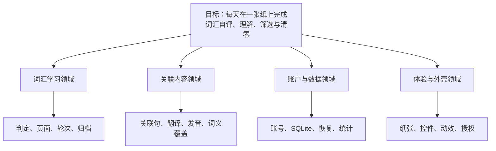

# 白纸英语 · 目标金字塔

## 一、边界与术语

这是产品目标的唯一入口。本文只回答要什么、为什么和如何验收；设计事实与工程标准不写在这里。

| 编号 | 术语 | 定义 |
| --- | --- | --- |
| TERM-SHEET | 白纸 | 一轮学习所用的 A4 词纸 |
| TERM-ASSOC | 关联辅助 | 一个目标词 + 8 个外围词 + 8 句英文 |
| TERM-CURSOR | 学习游标 | 当前轮次停在第几个词，九宫格与关联辅助共用 |
| TERM-CYCLE | 圈 | 从整本书第一轮开始，到清零为止的完整学习周期 |
| TERM-STREAK | 三圈绿标 | 连续三个圈的第一轮，同一个词最终都判为会 |

当前不覆盖：移动端原生 App、写作/语法课程、长期复习算法、多人协作、跨设备冲突合并。

## 二、金字塔图

## 四、文字金字塔

<!-- goal-summary -->
合计 31 条：已验证 31（验证于 2026-11-09-23-56）
<!-- /goal-summary -->

- **目标**：让一个人每天在一张纸上完成词汇自评、理解、筛选与清零。

  - **词汇学习领域**
    - 事件链：打开词书 → 扫词 → 判定 → 关联 → 归档/清零
    - 聚合：词卡、页面、轮次、圈、垃圾桶
    - 边界：管词汇判定、页面规则、轮次、归档和筛选；不管写作评分、语法课程和长期复习算法
    - 为什么这样切：判定、页面、轮次和归档共享同一条学习事件链；拆开会让红绿规则、游标和统计互相污染
    - 术语：红页 = 本页以不会为主；绿页 = 本页以会为主；灰词 = 已归档但仍占位
    - **REQ-WHITEPAPER-001 用户拥有自己的输入、判断、原文和确认后的成果；基础内容可编辑、可导出，AI 辅助不能替用户宣布掌握。**
      - 来源事件：打开词书 → 扫词 → 判定 → 关联 → 清零
      - 规则：用户拥有自己的输入、判断、原文和确认后的成果；基础内容可编辑、可导出，AI 辅助不能替用户宣布掌握。
      - AC-WHITEPAPER-001（REQ-WHITEPAPER-001）：Given 用户形成词表、原文或总结，When 编辑、保存或导出，Then 用户原始内容和确认后的版本可找回，辅助内容不会覆盖原文。
        - **测试用例**：用户形成词表、原文或总结，When 编辑、保存或导出，Then 用户原始内容和确认后的版本可找回 ｜ **状态**：已验证 ｜ [tests](../tests/contracts/product-goal.test.ts)
    - **REQ-WHITEPAPER-002 页面遵循纸张、黑字、留白、低干扰和窄屏可读性；任何颜色状态都有文字、名称或其他可访问表达。**
      - 来源事件：打开词书 → 扫词 → 判定 → 页面缩放
      - 规则：桌面纸张按剩余高度自适应，最大 6×6，36 词一屏；顶部保留小间距；顶栏收起时不覆盖纸张，展开时参与布局把纸张向下压；页面可纵向滚动但不显示右侧滚动条；左侧抽屉、顶栏和右侧标签按同一视口高度比例缩放；右侧标签必须单列；长单词不拆行，词组按空格换行；颜色状态不能是唯一表达；翻页、打乱、清空等自解释操作不弹提示，只保留阻断错误、自动归档和导入失败提示。
      - AC-WHITEPAPER-002（REQ-WHITEPAPER-002）：Given 桌面或窄屏学习路径，When 用户完成一次判断并调整窗口，Then 纸张完整、六列可读、控件不重叠、状态不只依赖颜色，且快速移动到左/上边缘仍能打开对应抽屉。
        - **测试用例**：桌面或窄屏学习路径，When 用户完成一次判断，Then 文字可读、控件可达、会/不会状态不只依赖颜色 ｜ **状态**：已验证 ｜ [tests](../tests/contracts/product-goal.test.ts)
    - **REQ-WHITEPAPER-003 本阶段不自动开通付费、云服务、教材分发或外部模型；需要这些能力时另立规格、权限、成本和验收。**
      - 来源事件：打开产品 → 打开设置
      - 规则：本阶段不自动开通付费、云服务、教材分发或外部模型；需要这些能力时另立规格、权限、成本和验收。
      - AC-WHITEPAPER-003（REQ-WHITEPAPER-003）：Given 当前阶段未接入付费、云服务或外部模型，When 核对页面和运行配置，Then 不出现虚假的商业能力或已完成的 AI 结果。
        - **测试用例**：当前阶段未接入付费、云服务或外部模型，When 核对页面和运行配置，Then 不出现虚假的商业能 ｜ **状态**：已验证 ｜ [tests](../tests/contracts/product-goal.test.ts)
    - **REQ-VOCABULARY-012 清空当前页判定**
      - 来源事件：当前页已标记 → 点击本页清空
      - 规则：只清除当前页词条的会/不会标记；不移动游标、不进入下一页、不改变其他页、轮次或垃圾桶。
      - AC-VOCABULARY-012（REQ-VOCABULARY-012）：Given 当前页已有会/不会标记，When 点击“本页清空”，Then 当前页所有标记清除并回到未判定状态，游标和其他页保持不变，垃圾桶也不受影响。
        - **测试用例**：当前页已有标记 → 点击本页清空 → 只清当前页 ｜ **状态**：已验证 ｜ [tests](../tests/e2e/vocabulary-polish.spec.ts)
    - **REQ-ACCOUNT-012 点击词条或关联句时播放美式发音；优先服务端神经语音，服务不可用时用系统最佳英文语音兜底；不提供手动音色选择。**
      - 来源事件：点击词条、点击关联句
      - 规则：点击词条或关联句时播放美式发音；优先服务端神经语音，服务不可用时用系统最佳英文语音兜底；不提供手动音色选择；连续快速点击时只有最后一次点击的音频可以开始，旧音频必须被停止。
      - AC-ACCOUNT-012（REQ-ACCOUNT-012）：Given 词汇白纸已打开，When 快速连续点击多个词，Then 最终只播放最后点击的词，旧音频不会在延迟后重新响起。
        - **测试用例**：快速连续点击多个词 → 只播放最后点击的词 ｜ **状态**：已验证 ｜ [tests](../tests/e2e/pronunciation.spec.ts)
    - **REQ-ACCOUNT-014 九宫格扫词与关联辅助共用同一学习游标；切换视图不重置位置，页面历史与词历史分离。**
      - 来源事件：九宫格翻页 → 切到关联辅助 → 前一页/后一页
      - 规则：九宫格页面从 pageStart 开始，关联辅助从游标当前词开始；关联辅助按九宫格真实视觉顺序从左到右、从上到下推进；拖词到关联辅助时从该词开始；九宫格上一页只恢复 page 历史，关联辅助上一词只恢复 word 历史；切换视图不恢复旧 view；打乱本页只打乱当前完整页，不能从页中间切片。
      - AC-ACCOUNT-014（REQ-ACCOUNT-014）：Given 九宫格已翻到任意一页并切到关联辅助，When 逐词前进或后退，Then 顺序与九宫格视觉顺序一致；切回九宫格后上一页只按页回退；页中位置打乱仍覆盖整页全部词。
        - **测试用例**：九宫格第2页 → 关联辅助走5词 → 切回九宫格 → 上一页实际回到第1页 ｜ **状态**：已验证 ｜ [tests](../tests/e2e/associations.spec.ts)
    - **REQ-ACCOUNT-015 关联辅助按当前页批量预取并缓存；进入只发一次批量请求，连续换词不再逐词请求；加载中保留目标词和骨架。**
      - 来源事件：打开关联辅助 → 连续下一词
      - 规则：关联辅助按当前页批量预取并缓存；进入只发一次批量请求，连续换词不再逐词请求；加载中保留目标词和骨架。
      - AC-ACCOUNT-015（REQ-ACCOUNT-015）：Given 打开关联辅助，When 当前批次加载完成，Then 只请求一次批量接口；连续点 5 次“下一词”不再发关联请求，8 个节点保持可见；加载失败时保留骨架而不是空白页。
        - **测试用例**：打开关联辅助，When 当前批次加载完成，Then 只请求一次批量接口 ｜ **状态**：已验证 ｜ [tests](../tests/e2e/vocabulary-polish.spec.ts)
    - **REQ-ACCOUNT-016 关联辅助的 8 个外围句子可点击朗读整句；中心目标词遵循与九宫格一致的红绿规则。**
      - 来源事件：打开关联辅助 → 点击中心词/外围句
      - 规则：外围句点击朗读整句；中心词左键显示/隐藏全部翻译并同步标红/取消红，右键标绿；红绿不能混用；从扫词带红标进入关联时翻译默认显示；中心词中文颜色跟随最终标记，不出现“默认背景+红色翻译”的错位。
      - AC-ACCOUNT-016（REQ-ACCOUNT-016）：Given 关联辅助显示 8 条句子，When 点击外围句或中心词，Then 外围句朗读整句；中心词左键第一次显示翻译并标红，再点隐藏并取消红；右键标绿；红绿冲突被阻断。
        - **测试用例**：关联辅助显示 8 条句子，When 点击任一句子节点，Then 朗读该节点整句 ｜ **状态**：已验证 ｜ [tests](../tests/e2e/vocabulary-polish.spec.ts)
    - **REQ-ACCOUNT-017 登录与设置使用白纸视觉；登录/注册面板高度固定一致；顶部不提供“剪到另一张纸”。**
      - 来源事件：打开登录/注册 → 切换模式 → 打开设置
      - 规则：登录与设置使用白纸视觉；登录和注册面板固定同高；切换模式不改变容器高度；登录/注册底部不出现多余说明；顶部不提供“剪到另一张纸”；桌面纸张高度自适应，顶栏参与布局，左侧抽屉/顶栏/右侧标签按视口高度统一缩放，右侧标签永远单列。
      - AC-ACCOUNT-017（REQ-ACCOUNT-017）：Given 打开登录面板，When 在登录和注册之间切换，Then 两个面板高度一致、无内部滚动，关闭后回到词汇白纸，设置里没有手动音色选择。
        - **测试用例**：登录与注册切换 → 面板高度一致，无内部滚动 ｜ **状态**：已验证 ｜ [tests](../tests/e2e/vocabulary-polish.spec.ts)
    - **REQ-ACCOUNT-018 重置今天在设置面板内二次确认；确认后关闭面板、回到第 1 页并显示清零提示。**
      - 来源事件：设置 → 重置今天
      - 规则：重置今天在设置面板内二次确认；确认后关闭面板、回到第 1 页并显示清零提示；只清当前轮次，保留历史圈与三圈绿标。
      - AC-ACCOUNT-018（REQ-ACCOUNT-018）：Given 设置里点“重置今天这本书”，When 在面板内确认，Then 面板关闭、页面回到第 1 页并显示“今日进度已清零”，历史圈与三圈绿标仍保留。
        - **测试用例**：设置里点“重置今天这本书”，When 在面板内确认，Then 面板关闭、页面回到第 1 页 ｜ **状态**：已验证 ｜ [tests](../tests/e2e/vocabulary-polish.spec.ts)
    - **REQ-ACCOUNT-020 垃圾桶排除不再推送的词**
      - 来源事件：把九宫格词条或关联辅助中心词拖到垃圾桶 → 打开垃圾桶 → 放回
      - 规则：把九宫格任意词块或关联辅助中心词拖到垃圾桶加入当前词书的垃圾桶；归档时按“会”处理并覆盖原有“不会”判定；当前页和当前记录仍保留该词，只从下一轮及以后排除；两边共用同一份排除表；被排除的词不再进入当前轮或之后的轮次；单击仍按原语义判定/发音，关联外围句子不归档；垃圾桶按删除逆序展示，最新删除在第一页；关闭垃圾桶清空搜索与分页；对话框高度固定，网格内部滚动；全部放回必须使用站内确认；三圈自动归档只在当前圈第一轮完整结束后结算，一个圈只贡献一次，重置不能伪造新圈，已归档词跳过累计。
      - AC-ACCOUNT-020（REQ-ACCOUNT-020）：Given 用户在当前词书看到词条，When 把词拖入垃圾桶，Then 该词进入共享垃圾桶并按删除逆序显示，归档后按会处理，当前页仍保留，下一轮及以后不再出现；When 打开垃圾桶并放回，Then 该词从排除表移除并在之后轮次恢复推送；When 关闭后重开，Then 搜索为空；When 全部放回，Then 先出现站内确认而不是浏览器原生弹窗。
        - **测试用例**：拖入词块 → 归档后按会处理、当前页保留、最新项在第一页；关联外围句子不归档 ｜ **状态**：已验证 ｜ [tests](../tests/e2e/trash.spec.ts)

  - **关联内容领域**
    - 事件链：选词 → 取关联句 → 看英文 → 展开中文 → 朗读 → 收藏/造句
    - 聚合：目标词、词义、关联词、关联句、翻译、收藏
    - 边界：管关联内容质量、翻译、发音与收藏；不管账户归属、页面游标和长期复习算法
    - 为什么这样切：关联句的质量、词义覆盖和翻译共享同一内容生命周期；和账户/页面混在一起会让内容问题被状态问题掩盖
    - 术语：关联句 = 目标词与外围词同时出现的短句；词义覆盖 = 目标词每个主要义项至少有一条关联句
    - **REQ-ACCOUNT-013 关联辅助按目标词返回 8 条真实短句，句子同时包含目标词和外围词；每个主要词义至少覆盖一条。**
      - 来源事件：进入关联辅助 → 查看 8 条句子
      - 规则：每个目标词至少 8 条真实短句；句子同时包含目标词和外围词；多义词的每个主要义项至少有一条；中文释义与英文句子对应；中心词和外围词在英文/中文中都要被识别；不能为了通过校验硬塞错误义项。
      - AC-ACCOUNT-013（REQ-ACCOUNT-013）：Given 关联数据里存在 lesson，When 请求关联接口，Then 返回 lesson 的 8 条句子，每条包含 lesson；多义词的两个主要义项各至少有一条句子；中文翻译不丢失；关联数据为空或句子失败时不得伪造，必须暴露缺口；内置 8 条可关闭，自定义句最多 4 条，默认与自定义合计最多 12 张卡片，9–12 张使用 4×4 周边布局，移除的默认句和自定义句可逐条还原，设置与自定义句按词书隔离。
        - **测试用例**：关联数据里存在 lesson，When 请求关联接口，Then 返回 lesson 的 8 条句 ｜ **状态**：已验证 ｜ [tests](../tests/e2e/associations.spec.ts)
    - **REQ-EXPERIENCE-002 关联句与纸面同底；翻译和加粗不破坏纸张视觉。**
      - 来源事件：打开关联辅助、展开翻译
      - 规则：句子、词和节点使用纸面底色；展开翻译后中心词、外围词和例句翻译的颜色保持一致；中文不能出现“默认背景配红字”的错位；长句不撑破节点。
      - AC-EXPERIENCE-002（REQ-EXPERIENCE-002）：Given 打开关联辅助，When 展开或收起翻译，Then 句子与纸面同底，中心词/外围词/例句翻译颜色与标记一致，没有孤立白块。
        - **测试用例**：查看关联辅助 → 句子与纸面融合 ｜ **状态**：已验证 ｜ [tests](../tests/contracts/experience.test.ts)

  - **账户与数据领域**
    - 事件链：注册 → 登录 → 保存判定 → 恢复进度 → 重置今天
    - 聚合：账号、词状态、每日会话、SQLite desk
    - 边界：管身份、归属、按天保存、恢复和统计；不管团队、权限分级、跨设备冲突合并
    - 为什么这样切：账号与学习数据共享归属和恢复生命周期；合并进词汇领域会让权限校验和扫词交互互相污染
    - 术语：词状态 = 某天某词的会/不会；每日会话 = 当天的轮次与游标；desk = 某个账号某本词书的完整学习状态
    - **REQ-WHITEPAPER-004 未登录用户可以开始词汇学习；账户只用于同步、备份和跨设备恢复。**
      - 来源事件：打开产品 → 登录/访客
      - 规则：未登录用户可以开始第一阶段词汇学习；账户只用于同步、备份和跨设备恢复。
      - AC-WHITEPAPER-004（REQ-WHITEPAPER-004）：Given 未登录访客，When 打开首页并点击第一入口，Then 不需要注册即可进入词汇白纸并开始本地学习。
        - **测试用例**：未登录访客，When 打开首页并点击第一入口，Then 不需要注册即可进入词汇白纸并开始本地学习 ｜ **状态**：已验证 ｜ [tests](../tests/contracts/product-goal.test.ts)
    - **REQ-ACCOUNT-001 学习状态接口只接受 session 身份。未登录访问返回 401；客户端传入的用户标识不能改变身份。账号数据的持久化和双账号隔离在独立 Plan 中定义规格与验收。**
      - 来源事件：注册 → 登录 → 保存判定 → 恢复进度 → 重置今天
      - 规则：学习状态接口只接受 session 身份；未登录访问返回 401；客户端传入的用户标识不能改变身份。
      - AC-ACCOUNT-001（REQ-ACCOUNT-001）：Given 未登录用户，When 访问账号学习状态，Then 看不到任何账号数据；登录后只看到自己的词状态。
        - **测试用例**：未登录用户看不到任何账号数据；登录后只看到自己的词状态 ｜ **状态**：已验证 ｜ [tests](../tests/api/vocabulary-state.test.ts)
    - **REQ-ACCOUNT-002 学习数据按账号持久化并隔离。两个账号保存的词状态互不可见，读取只返回当前 session 用户自己的记录；主存储为 SQLite vocabulary_desk，匿名账号自动创建，登录时合并匿名 desk，页面隐藏时触发一次保存。**
      - 来源事件：注册 → 登录 → 保存判定 → 恢复进度 → 重置今天
      - 规则：学习数据按账号持久化并隔离；两个账号保存的词状态互不可见；读取只返回当前 session 用户自己的记录。
      - AC-ACCOUNT-002（REQ-ACCOUNT-002）：Given 账号 A 和账号 B 各自保存词状态，When 分别读取自己的词状态，Then 只返回本账号保存的记录，看不到对方的记录。
        - **测试用例**：账号 A 和账号 B 各自保存词状态，When 分别读取自己的词状态，Then 只返回本账号保存 ｜ **状态**：已验证 ｜ [tests](../tests/contracts/product-goal.test.ts)
    - **REQ-ACCOUNT-003 学习状态接口返回当前 session 用户已经保存的词状态，而不是固定空数组。**
      - 来源事件：登录 → 读取状态
      - 规则：学习状态接口返回当前 session 用户已经保存的词状态，而不是固定空数组。
      - AC-ACCOUNT-003（REQ-ACCOUNT-003）：Given 账号 A 已保存词状态，When A 请求 /api/vocabulary/state，Then 返回 A 自己的词状态，而不是空数组。
        - **测试用例**：账号 A 已保存词状态，When A 请求 /api/vocabulary/state，Then 返回 A 自己的词状态 ｜ **状态**：已验证 ｜ [tests](../tests/api/vocabulary-state-data.test.ts)
    - **REQ-ACCOUNT-004 词汇白纸提供可见的登录入口；登录或注册成功后回到词汇白纸，退出后回到访客状态。**
      - 来源事件：登录 → 注册 → 退出
      - 规则：词汇白纸提供可见的登录入口；登录或注册成功后回到词汇白纸；退出后回到访客状态。
      - AC-ACCOUNT-004（REQ-ACCOUNT-004）：Given 访客打开词汇白纸，When 点击登录并完成注册，Then 回到 /vocabulary 且显示退出；点击退出后重新显示登录。
        - **测试用例**：访客打开词汇白纸，When 点击登录并完成注册，Then 回到 /vocabulary 且显示退出 ｜ **状态**：已验证 ｜ [tests](../tests/e2e/auth-entry.spec.ts)
    - **REQ-ACCOUNT-005 登录用户可以批量提交当前页的会/不会判定；同一账号同一词重复提交时覆盖旧值，其他账号不可见。**
      - 来源事件：登录 → 翻页 → 保存判定
      - 规则：登录用户可以批量提交当前页判定；同一账号同一词重复提交覆盖旧值；其他账号不可见。
      - AC-ACCOUNT-005（REQ-ACCOUNT-005）：Given 登录用户提交当前页，When 同一词再次提交，Then 只保留最新判定；其他账号不可见。
        - **测试用例**：账号只能读取和覆盖自己的词状态，其他账号不可见 ｜ **状态**：已验证 ｜ [tests](../tests/api/vocabulary-judgements.test.ts)
    - **REQ-ACCOUNT-006 登录用户点“下一页”时，当前页的判定提交到自己的账号；未登录用户只保存在本机。**
      - 来源事件：登录 → 下一页
      - 规则：登录用户点“下一页”时，当前页判定提交到自己的账号；未登录用户只保存在本机。
      - AC-ACCOUNT-006（REQ-ACCOUNT-006）：Given 登录用户在词汇白纸第一页，When 点击“下一页”，Then 当前页判定写入账号，读取状态返回这些词。
        - **测试用例**：登录用户在词汇白纸第一页，When 点击“下一页”，Then 当前页判定写入账号 ｜ **状态**：已验证 ｜ [tests](../tests/e2e/judgement-submit.spec.ts)
    - **REQ-ACCOUNT-007 登录用户点“上一页”时，可连续回退多页，并逐页保留每一页已有判定；刷新后判定仍在。**
      - 来源事件：登录 → 翻页 → 上一页
      - 规则：登录用户点“上一页”时，可连续回退多页，并逐页保留每一页已有判定；刷新后判定仍在。
      - AC-ACCOUNT-007（REQ-ACCOUNT-007）：Given 登录用户已提交第一页并进入第二页，When 连续点击“上一页”，Then 逐页回到更早页面且已有判定保留，账号状态不被删除。
        - **测试用例**：登录用户已提交第一页并进入第二页，When 点击“上一页”，Then 第一页的词从账号状态中 ｜ **状态**：已验证 ｜ [tests](../tests/e2e/judgement-undo.spec.ts)
    - **REQ-ACCOUNT-008 登录用户的每日轮次、页码和判定按账号保存；清掉本机存储或换标签页后刷新，仍能回到同一轮同一页。**
      - 来源事件：登录 → 刷新 → 恢复
      - 规则：登录用户的每日轮次、页码和判定按账号保存；清掉本机存储或换标签页后刷新，仍能回到同一轮同一页。
      - AC-ACCOUNT-008（REQ-ACCOUNT-008）：Given 登录用户已进入第二页，When 清除本地存储并刷新，Then 仍回到第二页，“上一页”可用。
        - **测试用例**：登录用户已进入第二页，When 清除本地存储并刷新，Then 仍回到第二页 ｜ **状态**：已验证 ｜ [tests](../tests/e2e/daily-session.spec.ts)
    - **REQ-ACCOUNT-009 词状态按词书和本地日期保存；读取按日期隔离，重置今天只影响今天，历史日期保留；统计以圈为单位，每页实时写入，按词书隔离，保留每轮汇总而不保留逐词历史。**
      - 来源事件：登录 → 跨日期读取
      - 规则：词状态按词书和本地日期保存；读取按日期隔离；重置今天只影响今天；历史日期保留。
      - AC-ACCOUNT-009（REQ-ACCOUNT-009）：Given 登录用户在 2026-11-08 提交 apple=true，When 读取 2026-11-09，Then 为空；读取 2026-11-08 返回 apple。
        - **测试用例**：登录用户在 2026-11-08 提交 apple=true，When 读取 2026-11-09 ｜ **状态**：已验证 ｜ [tests](../tests/api/vocabulary-daily-state.test.ts)
    - **REQ-ACCOUNT-010 设置里的“重新开始今天”清空当前词书当天的判定和会话，重建完整首轮；其他日期不受影响。**
      - 来源事件：设置 → 重新开始今天
      - 规则：清空当前词书当天的判定和会话；重建完整首轮；其他日期不受影响。
      - AC-ACCOUNT-010（REQ-ACCOUNT-010）：Given 登录用户已提交第一页，When 在设置里点“重新开始今天”并确认，Then 当天判定清空，页面回到第 1 轮。
        - **测试用例**：登录用户已提交第一页，When 在设置里点“重新开始今天”并确认，Then 当天判定清空 ｜ **状态**：已验证 ｜ [tests](../tests/e2e/reset-today.spec.ts)
    - **REQ-ACCOUNT-011 学习记录按天返回当前词书的词数、会、不会、轮次和是否完成；日期从新到旧。**
      - 来源事件：登录 → 查看学习记录
      - 规则：按天返回当前词书的词数、会、不会、轮次和是否完成；日期从新到旧。
      - AC-ACCOUNT-011（REQ-ACCOUNT-011）：Given 账号有 2026-11-07 和 2026-11-08 两天的会话与判定，When 请求学习记录，Then 按日期从新到旧返回词数、会、不会、轮次和完成状态。
        - **测试用例**：账号有 2026-11-07 和 2026-11-08 两天的会话与判定 ｜ **状态**：已验证 ｜ [tests](../tests/api/vocabulary-history.test.ts)

  - **体验与外壳领域**
    - 事件链：打开产品 → 看纸张 → 点控件 → 听声音
    - 聚合：视觉、动效、文案、导航、权限边界
    - 边界：管体感与外壳；不管词汇判定、关联内容和账户数据
    - 为什么这样切：体感与外壳共享“是否愿意停留”的目标；混进业务领域会让内容问题和体验问题互相掩盖
    - 术语：纸面同底 = 内容与纸张使用同一底色；无阻力 = 不需要现场查词或反复回看
    - **REQ-WHITEPAPER-005 首屏直接进入词汇白纸，不展示写作或语法入口。**
      - 来源事件：打开产品
      - 规则：首屏直接进入词汇白纸；不展示 Tasks、设置或模板说明；顶部不出现写作、学语法或“暂未开放”的假入口。
      - AC-WHITEPAPER-005（REQ-WHITEPAPER-005）：Given 产品入口，When 访问首页和工作台，Then 第一动作是进入词汇白纸，顶部没有写作、学语法或“暂未开放”的假入口。
        - **测试用例**：产品入口，When 访问首页和工作台，Then 只有词汇纸 ｜ **状态**：已验证 ｜ [tests](../tests/contracts/product-goal.test.ts)
    - **REQ-EXPERIENCE-001 发音优先服务端神经语音；缺失或失败才用系统语音，不提供手动音色选择。**
      - 来源事件：点击词条、点击关联句
      - 规则：词和关联句预生成静态音频，点击直接播放；缺失或失败才用系统英文语音；连续点击时旧播放必须失效；界面没有手动音色选择。
      - AC-EXPERIENCE-001（REQ-EXPERIENCE-001）：Given 词或句已有预生成音频，When 点击词条或关联句，Then 立即播放静态音频；只有文件缺失或失败时才用系统语音；快速连续点击时旧音频不再启动。
        - **测试用例**：点击词条或句子 → 听到自然神经语音 ｜ **状态**：已验证 ｜ [tests](../tests/contracts/experience.test.ts)
    - **REQ-EXPERIENCE-003 动效短且可关闭；顶栏展开/收起推动纸张而不是覆盖。**
      - 来源事件：换词、切换视图、系统减少动态、悬停顶栏
      - 规则：节点 150ms 渐入；减少动态时关闭；tab 位置稳定；顶栏收起时参与布局留出顶部间距，展开时把纸张向下推并缩短，鼠标移开恢复。
      - AC-EXPERIENCE-003（REQ-EXPERIENCE-003）：Given 切换下一词、切换视图、系统开启减少动态或悬停顶栏，When 页面更新，Then 节点渐入或关闭动画，纸张不被覆盖，操作位置稳定。
        - **测试用例**：换词/切视图 → 动效短且操作位置不跳 ｜ **状态**：已验证 ｜ [tests](../tests/contracts/experience.test.ts)
    - **REQ-EXPERIENCE-004 只允许纸面词句被选中；拖动词块不选中路过文字。**
      - 来源事件：拖选九宫格词块、拖选关联句节点、拖动单词
      - 规则：只有词块和关联句文本可选中复制；顶部、设置和说明不可选；拖选后不触发判定或发音；按住拖动时清除选区并禁止选中路过词。
      - AC-EXPERIENCE-004（REQ-EXPERIENCE-004）：Given 打开词汇纸，When 拖选词块、关联句或拖动单词，Then 文本可复制；拖动期间不选中路过文字；点击空白或其他非可选区域时选区清除。
        - **测试用例**：拖选词块/句子 → 可复制；拖动单词 → 不选中路过词 ｜ **状态**：已验证 ｜ [tests](../tests/contracts/experience.test.ts)
    - **REQ-ADOPTION-001 产品身份统一使用“白纸英语 / WhitePaper English”，仓库为 morewhyhan/whitepaper-english；品牌、站点说明、导航、cookie slug、README 和 .ai 项目身份必须使用同一份命名。**
      - 来源事件：打开产品 → 检查品牌
      - 规则：品牌、站点说明、导航、cookie slug、README 和 .ai 项目身份使用同一份命名。
      - AC-ADOPTION-001（REQ-ADOPTION-001）：Given 项目完成身份采用，When 检查 README、站点配置、项目身份、cookie slug、导航和仓库信息，Then 全部使用白纸英语命名，原始 BUSINESS_MODEL.md 未被改写。
        - **测试用例**：项目完成身份采用，When 检查 README、站点配置、项目身份 ｜ **状态**：已验证 ｜ [tests](../tests/contracts/product-goal.test.ts)
    - **REQ-ADOPTION-002 工程底座沿用模板的类型安全、认证边界、模块目录、RPC、Prisma 和验证体系；产品名称、首页、工作台、导航、视觉和业务领域不继续使用 Ignite 示例语义。**
      - 来源事件：打开产品 → 检查工程边界
      - 规则：沿用类型安全、认证边界、模块目录、RPC、Prisma 和验证体系；产品界面不继续使用 Ignite 示例语义。
      - AC-ADOPTION-002（REQ-ADOPTION-002）：Given 保留模板工程底座，When 检查目录和依赖，Then Next.js、React、TypeScript、Hono、Prisma、React Query、Better Auth 与测试治理仍可用，且产品界面不以 Ignite 作为用户-facing 身份。
        - **测试用例**：保留模板工程底座，When 检查目录和依赖 ｜ **状态**：已验证 ｜ [tests](../tests/contracts/product-goal.test.ts)
