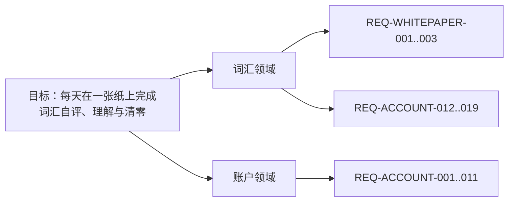

# 目标树（需求真源）

一份文档说清要什么、做到哪。开头是介绍与边界，中间是图，下面是逐级的文字金字塔。

## 这份文档只能由人写

GOAL 不交给 AI 生成。AI 可以和人对齐、提问、检查、把话整理清楚，但不能替人决定目标、领域、规则和验收。

理由：这份文档是人和 AI 之间的契约，契约的条款必须由人确认。AI 的职责只有两件：读它，把测试结果和证据写回对应 AC。

## 一、这份文档是什么

整套文档的唯一入口，也是人和 Agent 之间的接口。

它管目标、领域、REQ、AC 和测试用例；不管系统长什么样（[设计事实](designs/)），也不管怎么写（[工程标准](standards/)）。

| 编号 | 术语 | 定义 |
| --- | --- | --- |
| TERM-SHEET | 白纸 | 一轮学习所用的 A4 词纸 |
| TERM-ASSOC | 关联辅助 | 一个目标词 + 8 个外围词 + 8 句英文 |
| TERM-CURSOR | 学习游标 | 当前轮次停在第几个词，九宫格与关联辅助共用 |

**当前不覆盖**：

```text
1. 移动端原生 App
2. 写作/语法课程
3. 长期复习算法
4. 多人协作
```

## 二、金字塔（图）



## 三、金字塔（文字）

<!-- goal-summary -->
合计 31 条：已验证 31（验证于 2026-11-09-23-56）
<!-- /goal-summary -->

- **目标**：让一个人每天在一张纸上完成词汇自评、理解与清零。

  - **词汇领域**（核心子域）
    - 事件链：打开词书 → 扫词 → 判定 → 关联 → 清零
    - 聚合：词卡、轮次、关联网络（词卡属于词书；轮次属于当天）
    - 边界：管词汇学习、判定与关联；不管写作评分、语法课程、长期复习算法
    - 为什么这样切：词卡、轮次和关联共享同一学习事件链；写作/语法是独立产出，混入会让判定和内容生成互相污染
    - 术语：词卡 = 一个唯一词头；关联辅助 = 1 个目标词 + 8 个外围词 + 8 句英文
    - **REQ-WHITEPAPER-001 用户拥有自己的输入、判断、原文和确认后的成果；基础内容可编辑、可导出，AI 辅助不能替用户宣布掌握。**
      - 来源事件：打开词书 → 扫词 → 判定 → 关联 → 清零
      - 规则：用户拥有自己的输入、判断、原文和确认后的成果；基础内容可编辑、可导出，AI 辅助不能替用户宣布掌握。
      - AC-WHITEPAPER-001（REQ-WHITEPAPER-001）：Given 用户形成词表、原文或总结，When 编辑、保存或导出，Then 用户原始内容和确认后的版本可找回，辅助内容不会覆盖原文。
        - **测试用例**：用户形成词表、原文或总结，When 编辑、保存或导出，Then 用户原始内容和确认后的版本可找回 ｜ **状态**：已验证 ｜ [用例](others/test-cases/vocabulary.md) · [tests](../tests/contracts/product-goal.test.ts) · [查看](others/evidence/goal-runs/2026-11-08-21-49.txt)
    - **REQ-WHITEPAPER-002 页面遵循纸张、黑字、留白、低干扰和窄屏可读性；任何颜色状态都有文字、名称或其他可访问表达。**
      - 来源事件：打开词书 → 扫词 → 判定 → 关联 → 清零
      - 规则：页面遵循纸张、黑字、留白、低干扰和窄屏可读性；任何颜色状态都有文字、名称或其他可访问表达。
      - AC-WHITEPAPER-002（REQ-WHITEPAPER-002）：Given 桌面或窄屏学习路径，When 用户完成一次判断，Then 文字可读、控件可达、会/不会状态不只依赖颜色。
        - **测试用例**：桌面或窄屏学习路径，When 用户完成一次判断，Then 文字可读、控件可达、会/不会状态不只依 ｜ **状态**：已验证 ｜ [用例](others/test-cases/vocabulary.md) · [tests](../tests/contracts/product-goal.test.ts) · [查看](others/evidence/goal-runs/2026-11-08-21-49.txt)
    - **REQ-WHITEPAPER-003 本阶段不自动开通付费、云服务、教材分发或外部模型；需要这些能力时另立规格、权限、成本和验收。**
      - 来源事件：打开词书 → 扫词 → 判定 → 关联 → 清零
      - 规则：本阶段不自动开通付费、云服务、教材分发或外部模型；需要这些能力时另立规格、权限、成本和验收。
      - AC-WHITEPAPER-003（REQ-WHITEPAPER-003）：Given 当前阶段未接入付费、云服务或外部模型，When 核对页面和运行配置，Then 不出现虚假的商业能力或已完成的 AI 结果。
        - **测试用例**：当前阶段未接入付费、云服务或外部模型，When 核对页面和运行配置，Then 不出现虚假的商业能 ｜ **状态**：已验证 ｜ [用例](others/test-cases/vocabulary.md) · [tests](../tests/contracts/product-goal.test.ts) · [查看](others/evidence/goal-runs/2026-11-08-21-49.txt)
    - **REQ-ACCOUNT-012 点击词条或关联句时播放美式发音；优先服务端神经语音，服务不可用时用系统最佳英文语音兜底；不提供手动音色选择。**
      - 来源事件：打开词书 → 扫词 → 判定 → 关联 → 清零
      - 规则：点击词条或关联句时播放美式发音；优先服务端神经语音，服务不可用时用系统最佳英文语音兜底；不提供手动音色选择。
      - AC-ACCOUNT-012（REQ-ACCOUNT-012）：Given 词汇白纸已打开，When 点击一个词条，Then 以 en-US 调用系统语音播放该词。
        - **测试用例**：词汇白纸已打开，When 点击一个词条，Then 以 en-US 调用系统语音播放该词。 ｜ **状态**：已验证 ｜ [用例](others/test-cases/vocabulary.md) · [tests](../tests/e2e/pronunciation.spec.ts) · [查看](others/evidence/AC-ACCOUNT-012/2026-11-09.png)
    - **REQ-ACCOUNT-013 关联辅助按目标词返回 8 条真实短句，句子同时包含目标词和外围词。**
      - 来源事件：打开词书 → 扫词 → 判定 → 关联 → 清零
      - 规则：关联辅助按目标词返回 8 条真实短句，句子同时包含目标词和外围词。
      - AC-ACCOUNT-013（REQ-ACCOUNT-013）：Given 关联数据里存在 lesson，When 请求关联接口，Then 返回 lesson 的 8 条句子，每条包含 lesson。
        - **测试用例**：关联数据里存在 lesson，When 请求关联接口，Then 返回 lesson 的 8 条句 ｜ **状态**：已验证 ｜ [用例](others/test-cases/vocabulary.md) · [tests](../tests/e2e/associations.spec.ts) · [查看](others/evidence/AC-ACCOUNT-013/2026-11-09.png)
    - **REQ-ACCOUNT-014 九宫格扫词与关联辅助共用同一学习游标。切换视图不重置位置；任一视图推进后，另一视图从同一位置继续，不重复已过词。**
      - 来源事件：打开词书 → 扫词 → 判定 → 关联 → 清零
      - 规则：九宫格扫词与关联辅助共用同一学习游标。切换视图不重置位置；任一视图推进后，另一视图从同一位置继续，不重复已过词。
      - AC-ACCOUNT-014（REQ-ACCOUNT-014）：Given 九宫格已推进到第 73 个词，When 切到关联辅助，Then 显示第 73 个词；When 在关联辅助推进一词再切回九宫格，Then 从第 74 个词继续，不回到第 1 个。
        - **测试用例**：九宫格已推进到第 73 个词，When 切到关联辅助，Then 显示第 73 个词；When 在 ｜ **状态**：已验证 ｜ [用例](others/test-cases/vocabulary.md) · [tests](../tests/e2e/associations.spec.ts) · [查看](others/evidence/AC-ACCOUNT-014/2026-11-09.png)
    - **REQ-ACCOUNT-015 关联辅助按当前 36 词批量预取并缓存；进入只发一次批量请求，连续换词不再逐词请求；加载中保留目标词和骨架。**
      - 来源事件：打开词书 → 扫词 → 判定 → 关联 → 清零
      - 规则：关联辅助按当前 36 词批量预取并缓存；进入只发一次批量请求，连续换词不再逐词请求；加载中保留目标词和骨架。
      - AC-ACCOUNT-015（REQ-ACCOUNT-015）：Given 打开关联辅助，When 当前批次加载完成，Then 只请求一次批量接口；连续点 5 次“下一词”不再发关联请求，8 个节点保持可见。
        - **测试用例**：打开关联辅助，When 当前批次加载完成，Then 只请求一次批量接口；连续点 5 次“下一词” ｜ **状态**：已验证 ｜ [用例](others/test-cases/vocabulary.md) · [tests](../tests/e2e/vocabulary-polish.spec.ts) · [查看](others/evidence/AC-ACCOUNT-015/2026-11-09.png)
    - **REQ-ACCOUNT-016 关联辅助的 8 个外围句子可点击朗读整句；目标词点击朗读单词并按当前模式判定。**
      - 来源事件：打开词书 → 扫词 → 判定 → 关联 → 清零
      - 规则：关联辅助的 8 个外围句子可点击朗读整句；目标词点击朗读单词并按当前模式判定。
      - AC-ACCOUNT-016（REQ-ACCOUNT-016）：Given 关联辅助显示 8 条句子，When 点击任一句子节点，Then 朗读该节点整句，文本与节点句子一致。
        - **测试用例**：关联辅助显示 8 条句子，When 点击任一句子节点，Then 朗读该节点整句，文本与节点句子一 ｜ **状态**：已验证 ｜ [用例](others/test-cases/vocabulary.md) · [tests](../tests/e2e/vocabulary-polish.spec.ts) · [查看](others/evidence/AC-ACCOUNT-016/2026-11-09.png)
    - **REQ-ACCOUNT-017 登录与设置使用白纸视觉；顶部不提供“剪到另一张纸”。**
      - 来源事件：打开词书 → 扫词 → 判定 → 关联 → 清零
      - 规则：登录与设置使用白纸视觉；顶部不提供“剪到另一张纸”。
      - AC-ACCOUNT-017（REQ-ACCOUNT-017）：Given 服务端神经语音未加载完成或不可用，When 点击词条或句子，Then 用系统英文语音朗读；设置里没有手动音色选择。
        - **测试用例**：服务端神经语音未加载完成或不可用，When 点击词条或句子，Then 用系统英文语音朗读；设置里没 ｜ **状态**：已验证 ｜ [用例](others/test-cases/vocabulary.md) · [tests](../tests/e2e/vocabulary-polish.spec.ts) · [查看](others/evidence/AC-ACCOUNT-017/2026-11-09.png)
    - **REQ-ACCOUNT-018 重置今天在设置面板内二次确认；确认后关闭面板、回到第 1 页并显示清零提示。**
      - 来源事件：打开词书 → 扫词 → 判定 → 关联 → 清零
      - 规则：重置今天在设置面板内二次确认；确认后关闭面板、回到第 1 页并显示清零提示。
      - AC-ACCOUNT-018（REQ-ACCOUNT-018）：Given 设置里点“重置今天这本书”，When 在面板内确认，Then 面板关闭、页面回到第 1 页并显示“今日进度已清零”。
        - **测试用例**：设置里点“重置今天这本书”，When 在面板内确认，Then 面板关闭、页面回到第 1 页并显示 ｜ **状态**：已验证 ｜ [用例](others/test-cases/vocabulary.md) · [tests](../tests/e2e/vocabulary-polish.spec.ts) · [查看](others/evidence/AC-ACCOUNT-018/2026-11-09.png)
  - **账户领域**（支撑子域）
    - 事件链：注册 → 登录 → 保存判定 → 恢复进度 → 重置今天
    - 聚合：账号、词状态、每日会话（词状态属于账号与当天）
    - 边界：管身份、归属、按天保存；不管团队、权限分级、跨设备冲突合并
    - 为什么这样切：账号与学习数据共享归属和恢复生命周期；合并进词汇领域会让权限校验和扫词交互互相污染
    - 术语：词状态 = 某天某词的会/不会；每日会话 = 当天的轮次与游标
    - **REQ-ACCOUNT-001 学习状态接口只接受 session 身份。未登录访问返回 401；客户端传入的用户标识不能改变身份。账号数据的持久化和双账号隔离在独立 Plan 中定义规格与验收。**
      - 来源事件：注册 → 登录 → 保存判定 → 恢复进度 → 重置今天
      - 规则：学习状态接口只接受 session 身份。未登录访问返回 401；客户端传入的用户标识不能改变身份。账号数据的持久化和双账号隔离在独立 Plan 中定义规格与验收。
      - AC-ACCOUNT-001（REQ-ACCOUNT-001）：未登录用户看不到任何账号数据；登录后只看到自己的词状态。
        - **测试用例**：未登录用户看不到任何账号数据；登录后只看到自己的词状态。 ｜ **状态**：已验证 ｜ [用例](others/test-cases/product.md) · [tests](../tests/api/vocabulary-state.test.ts) · [查看](others/evidence/goal-runs/2026-11-08-21-49.txt)
    - **REQ-ACCOUNT-002 学习数据按账号持久化并隔离。两个账号保存的词状态互不可见，读取只返回当前 session 用户自己的记录。**
      - 来源事件：注册 → 登录 → 保存判定 → 恢复进度 → 重置今天
      - 规则：学习数据按账号持久化并隔离。两个账号保存的词状态互不可见，读取只返回当前 session 用户自己的记录。
      - AC-ACCOUNT-002（REQ-ACCOUNT-002）：Given 账号 A 和账号 B 各自保存词状态，When 分别读取自己的词状态，Then 只返回本账号保存的记录，看不到对方的记录。
        - **测试用例**：账号 A 和账号 B 各自保存词状态，When 分别读取自己的词状态，Then 只返回本账号保存 ｜ **状态**：已验证 ｜ [用例](others/test-cases/product.md) · [tests](../tests/contracts/product-goal.test.ts) · [查看](others/evidence/goal-runs/2026-11-08-21-49.txt)
    - **REQ-ACCOUNT-003 学习状态接口返回当前 session 用户已经保存的词状态，而不是固定空数组。**
      - 来源事件：注册 → 登录 → 保存判定 → 恢复进度 → 重置今天
      - 规则：学习状态接口返回当前 session 用户已经保存的词状态，而不是固定空数组。
      - AC-ACCOUNT-003（REQ-ACCOUNT-003）：Given 账号 A 已保存词状态，When A 请求 /api/vocabulary/state，Then 返回 A 自己的词状态，而不是空数组。
        - **测试用例**：账号 A 已保存词状态，When A 请求 /api/vocabulary/state，Then ｜ **状态**：已验证 ｜ [用例](others/test-cases/product.md) · [tests](../tests/api/vocabulary-state-data.test.ts) · [查看](others/evidence/goal-runs/2026-11-08-21-49.txt)
    - **REQ-ACCOUNT-004 词汇白纸提供可见的登录入口；登录或注册成功后回到词汇白纸，退出后回到访客状态。**
      - 来源事件：注册 → 登录 → 保存判定 → 恢复进度 → 重置今天
      - 规则：词汇白纸提供可见的登录入口；登录或注册成功后回到词汇白纸，退出后回到访客状态。
      - AC-ACCOUNT-004（REQ-ACCOUNT-004）：Given 访客打开词汇白纸，When 点击登录并完成注册，Then 回到 /vocabulary 且显示退出；点击退出后重新显示登录。
        - **测试用例**：访客打开词汇白纸，When 点击登录并完成注册，Then 回到 /vocabulary 且显示退 ｜ **状态**：已验证 ｜ [用例](others/test-cases/product.md) · [tests](../tests/e2e/auth-entry.spec.ts) · [查看](others/evidence/AC-ACCOUNT-004/2026-11-09.png)
    - **REQ-ACCOUNT-005 登录用户可以批量提交当前页的会/不会判定；同一账号同一词重复提交时覆盖旧值，其他账号不可见。**
      - 来源事件：注册 → 登录 → 保存判定 → 恢复进度 → 重置今天
      - 规则：登录用户可以批量提交当前页的会/不会判定；同一账号同一词重复提交时覆盖旧值，其他账号不可见。
      - AC-ACCOUNT-005（REQ-ACCOUNT-005）：账号只能读取和覆盖自己的词状态，其他账号不可见。
        - **测试用例**：账号只能读取和覆盖自己的词状态，其他账号不可见。 ｜ **状态**：已验证 ｜ [用例](others/test-cases/product.md) · [tests](../tests/api/vocabulary-judgements.test.ts) · [查看](others/evidence/goal-runs/2026-11-08-21-49.txt)
    - **REQ-ACCOUNT-006 登录用户点“下一页”时，当前页的判定提交到自己的账号；未登录用户只保存在本机。**
      - 来源事件：注册 → 登录 → 保存判定 → 恢复进度 → 重置今天
      - 规则：登录用户点“下一页”时，当前页的判定提交到自己的账号；未登录用户只保存在本机。
      - AC-ACCOUNT-006（REQ-ACCOUNT-006）：Given 登录用户在词汇白纸第一页，When 点击“下一页”，Then 当前页判定写入账号，读取状态返回这些词。
        - **测试用例**：登录用户在词汇白纸第一页，When 点击“下一页”，Then 当前页判定写入账号，读取状态返回这 ｜ **状态**：已验证 ｜ [用例](others/test-cases/product.md) · [tests](../tests/e2e/judgement-submit.spec.ts) · [查看](others/evidence/AC-ACCOUNT-006/2026-11-09.png)
    - **REQ-ACCOUNT-007 登录用户点“上一页”时，可连续回退多页，并逐页保留每一页已有判定；刷新后判定仍在。**
      - 来源事件：注册 → 登录 → 保存判定 → 恢复进度 → 重置今天
      - 规则：登录用户点“上一页”时，可连续回退多页，并逐页保留每一页已有判定；刷新后判定仍在。
      - AC-ACCOUNT-007（REQ-ACCOUNT-007）：Given 登录用户已提交第一页并进入第二页，When 点击“上一页”，Then 页面逐页回到更早页面且已有判定保留，账号状态不被删除。
        - **测试用例**：登录用户已提交第一页并进入第二页，When 点击“上一页”，Then 第一页的词从账号状态中 ｜ **状态**：已验证 ｜ [用例](others/test-cases/product.md) · [tests](../tests/e2e/judgement-undo.spec.ts) · [查看](others/evidence/AC-ACCOUNT-007/2026-11-09.png)
    - **REQ-ACCOUNT-008 登录用户的每日轮次、页码和判定按账号保存；清掉本机存储或换标签页后刷新，仍能回到同一轮同一页。**
      - 来源事件：注册 → 登录 → 保存判定 → 恢复进度 → 重置今天
      - 规则：登录用户的每日轮次、页码和判定按账号保存；清掉本机存储或换标签页后刷新，仍能回到同一轮同一页。
      - AC-ACCOUNT-008（REQ-ACCOUNT-008）：Given 登录用户已进入第二页，When 清除本地存储并刷新，Then 仍回到第二页，“上一页”可用。
        - **测试用例**：登录用户已进入第二页，When 清除本地存储并刷新，Then 仍回到第二页，“上一页”可用。 ｜ **状态**：已验证 ｜ [用例](others/test-cases/product.md) · [tests](../tests/e2e/daily-session.spec.ts) · [查看](others/evidence/AC-ACCOUNT-008/2026-11-09.png)
    - **REQ-ACCOUNT-009 词状态按词书和本地日期保存；读取按日期隔离，重置今天只影响今天，历史日期保留。**
      - 来源事件：注册 → 登录 → 保存判定 → 恢复进度 → 重置今天
      - 规则：词状态按词书和本地日期保存；读取按日期隔离，重置今天只影响今天，历史日期保留。
      - AC-ACCOUNT-009（REQ-ACCOUNT-009）：Given 登录用户在 2026-11-08 提交 apple=true，When 读取 2026-11-09，Then 为空；读取 2026-11-08 返回 apple。
        - **测试用例**：登录用户在 2026-11-08 提交 apple=true，When 读取 2026-11-0 ｜ **状态**：已验证 ｜ [用例](others/test-cases/product.md) · [tests](../tests/api/vocabulary-daily-state.test.ts) · [查看](others/evidence/goal-runs/2026-11-08-21-49.txt)
    - **REQ-ACCOUNT-010 设置里的“重新开始今天”清空当前词书当天的判定和会话，重建完整首轮；其他日期不受影响。**
      - 来源事件：注册 → 登录 → 保存判定 → 恢复进度 → 重置今天
      - 规则：设置里的“重新开始今天”清空当前词书当天的判定和会话，重建完整首轮；其他日期不受影响。
      - AC-ACCOUNT-010（REQ-ACCOUNT-010）：Given 登录用户已提交第一页，When 在设置里点“重新开始今天”并确认，Then 当天判定清空，页面回到第 1 轮。
        - **测试用例**：登录用户已提交第一页，When 在设置里点“重新开始今天”并确认，Then 当天判定清空，页面回 ｜ **状态**：已验证 ｜ [用例](others/test-cases/product.md) · [tests](../tests/e2e/reset-today.spec.ts) · [查看](others/evidence/AC-ACCOUNT-010/2026-11-09.png)
    - **REQ-ACCOUNT-011 学习记录按天返回当前词书的词数、会、不会、轮次和是否完成；日期从新到旧。**
      - 来源事件：注册 → 登录 → 保存判定 → 恢复进度 → 重置今天
      - 规则：学习记录按天返回当前词书的词数、会、不会、轮次和是否完成；日期从新到旧。
      - AC-ACCOUNT-011（REQ-ACCOUNT-011）：Given 账号有 2026-11-07 和 2026-11-08 两天的会话与判定，When 请求学习记录，Then 按日期从新到旧返回词数、会、不会、轮次和完成状态。
        - **测试用例**：账号有 2026-11-07 和 2026-11-08 两天的会话与判定，When 请求学习记录 ｜ **状态**：已验证 ｜ [用例](others/test-cases/product.md) · [tests](../tests/api/vocabulary-history.test.ts) · [查看](others/evidence/goal-runs/2026-11-08-21-49.txt)
    - **REQ-ACCOUNT-020 垃圾桶排除不再推送的词**
      - 来源事件：把九宫格词条或关联辅助中心词拖到垃圾桶 → 打开垃圾桶 → 放回
      - 规则：把九宫格任意词块或关联辅助中心词拖到垃圾桶加入当前词书的垃圾桶；归档时按“会”处理并覆盖原有“不会”判定；当前页和当前记录仍保留该词，只从下一轮及以后排除；两边共用同一份排除表；被排除的词不再进入当前轮或之后的轮次；单击仍按原语义判定/发音，关联外围句子不归档；垃圾桶可查看并放回
      - AC-ACCOUNT-020（REQ-ACCOUNT-020）：Given 用户在当前词书看到词条，When 把九宫格任意词块或关联辅助中心词拖到垃圾桶，Then 该词进入共享垃圾桶，归档后按会处理，当前页仍保留，角标增加，下一轮及以后不再出现；单击仍判定或发音，关联外围句子不归档；When 打开垃圾桶并放回，Then 该词从排除表移除并在之后轮次恢复推送。
        - **测试用例**：拖入词块 → 归档后按会处理、当前页保留、下一轮不推送；关联外围句子不归档 ｜ **状态**：已验证 ｜ [用例](others/test-cases/vocabulary.md) · [tests](../tests/e2e/trash.spec.ts) · [查看](others/evidence/AC-ACCOUNT-020/2026-11-10.png)
    - **REQ-VOCABULARY-012 清空当前页判定**
      - 来源事件：当前页已标记 → 点击本页清空
      - 规则：只清除当前页词条的会/不会标记；不移动游标、不进入下一页、不改变其他页、轮次或垃圾桶
      - AC-VOCABULARY-012（REQ-VOCABULARY-012）：Given 当前页已有会/不会标记，When 点击“本页清空”，Then 当前页所有标记清除并回到未判定状态，游标和其他页保持不变，垃圾桶也不受影响。
        - **测试用例**：当前页已有标记 → 点击本页清空 → 只清当前页 ｜ **状态**：已验证 ｜ [用例](others/test-cases/vocabulary.md) · [tests](../tests/e2e/vocabulary-polish.spec.ts) · [查看](others/evidence/AC-VOCABULARY-012/2026-11-10.png)
  - **体验领域**（支撑子域）
    - 事件链：点击 → 发声/反馈 → 切换
    - 聚合：声音、视觉、动效
    - 边界：管体感；不管词汇判定、账户归属或数据生成
    - 为什么这样切：声音、视觉和动效共享“用户是否愿意停留”的同一目标；混进词汇领域会让内容质量与体感质量互相掩盖
    - 术语：神经语音 = 服务端 Aria 生成的自然英文声音；纸面同底 = 句子与纸张使用同一底色
    - **REQ-EXPERIENCE-001 发音优先服务端神经语音**
      - 来源事件：点击词条、点击关联句
      - 规则：词和关联句预生成为静态音频，点击直接播放；缺失或失败才用系统英文语音；不提供手动音色选择
      - AC-EXPERIENCE-001（REQ-EXPERIENCE-001）：Given 词或句已有预生成音频，When 点击词条或关联句，Then 立即播放静态音频，不再现场合成；只有文件缺失或失败时才用系统语音，界面没有手动音色选择。
        - **测试用例**：点击词条或句子 → 听到自然神经语音 ｜ **状态**：已验证 ｜ [用例](others/test-cases/vocabulary.md) · [tests](../tests/contracts/experience.test.ts) · [查看](others/evidence/goal-runs/2026-11-08-22-24.txt)
    - **REQ-EXPERIENCE-002 关联句与纸面同底**
      - 来源事件：打开关联辅助、悬停节点
      - 规则：句子、词和节点使用纸面底色，不出现孤立白块；悬停整块一致
      - AC-EXPERIENCE-002（REQ-EXPERIENCE-002）：Given 打开关联辅助，When 查看或悬停 8 个句子节点，Then 句子与纸面同底，没有白色色块，节点整体反馈一致。
        - **测试用例**：查看关联辅助 → 句子与纸面融合 ｜ **状态**：已验证 ｜ [用例](others/test-cases/vocabulary.md) · [tests](../tests/contracts/experience.test.ts) · [查看](others/evidence/goal-runs/2026-11-08-22-24.txt)
    - **REQ-EXPERIENCE-003 动效短且可关闭**
      - 来源事件：换词、切换视图、系统减少动态
      - 规则：节点 150ms 渐入；减少动态时关闭；tab 位置稳定
      - AC-EXPERIENCE-003（REQ-EXPERIENCE-003）：Given 切换下一词、切换视图或系统开启减少动态，When 页面更新，Then 节点 150ms 渐入或关闭动画，顶部操作位置保持稳定。
        - **测试用例**：换词/切视图 → 动效短且操作位置不跳 ｜ **状态**：已验证 ｜ [用例](others/test-cases/vocabulary.md) · [tests](../tests/contracts/experience.test.ts) · [查看](others/evidence/goal-runs/2026-11-08-22-24.txt)
    - **REQ-EXPERIENCE-004 只允许纸面词句被选中**
      - 来源事件：拖选九宫格词块、拖选关联句节点
      - 规则：只有词块和关联句文本可选中复制；顶部、设置和说明不可选；拖选后不触发判定或发音
      - AC-EXPERIENCE-004（REQ-EXPERIENCE-004）：Given 打开词汇纸，When 拖选九宫格词块或关联句节点，Then 文本可复制；点击纸张空白或其他非可选区域时选区立即清除；拖选顶部或设置不会选中，也不触发判定。
        - **测试用例**：拖选词块/句子 → 可复制；点击空白 → 选区清除 ｜ **状态**：已验证 ｜ [用例](others/test-cases/vocabulary.md) · [tests](../tests/contracts/experience.test.ts) · [查看](others/evidence/goal-runs/2026-11-09-01-28.txt)
  - **外壳（非领域）**
    - 事件链：打开产品 → 切换模块 → 打开设置
    - 聚合：导航、设置面板、页面外壳
    - 边界：管路由、导航和设置布局；不管业务规则
    - 为什么这样切：外壳只组合领域，不承载业务规则
    - 术语：工作台 = 词汇学习纸的容器
    - **REQ-ADOPTION-001 产品身份统一使用“白纸英语 / WhitePaper English”，仓库为 `morewhyhan/whitepaper-english`；品牌、站点说明、导航、cookie slug、README 和 `.ai` 项目身份必须使用同一份命名。**
      - 来源事件：打开产品 → 切换模块 → 打开设置
      - 规则：产品身份统一使用“白纸英语 / WhitePaper English”，仓库为 `morewhyhan/whitepaper-english`；品牌、站点说明、导航、cookie slug、README 和 `.ai` 项目身份必须使用同一份命名。
      - AC-ADOPTION-001（REQ-ADOPTION-001）：Given 项目完成身份采用，When 检查 README、站点配置、项目身份、cookie slug、导航和仓库信息，Then 全部使用白纸英语命名，原始 BUSINESS_MODEL.md 未被改写。
        - **测试用例**：项目完成身份采用，When 检查 README、站点配置、项目身份、cookie slug、导航 ｜ **状态**：已验证 ｜ [用例](others/test-cases/product.md) · [tests](../tests/contracts/product-goal.test.ts) · [查看](others/evidence/goal-runs/2026-11-08-21-49.txt)
    - **REQ-ADOPTION-002 工程底座沿用模板的类型安全、认证边界、模块目录、RPC、Prisma 和验证体系；产品名称、首页、工作台、导航、视觉和业务领域不继续使用 Ignite 示例语义。**
      - 来源事件：打开产品 → 切换模块 → 打开设置
      - 规则：工程底座沿用模板的类型安全、认证边界、模块目录、RPC、Prisma 和验证体系；产品名称、首页、工作台、导航、视觉和业务领域不继续使用 Ignite 示例语义。
      - AC-ADOPTION-002（REQ-ADOPTION-002）：Given 保留模板工程底座，When 检查目录和依赖，Then Next.js、React、TypeScript、Hono、Prisma、React Query、Better Auth 与测试治理仍可用，且产品界面不再以 Ignite 作为用户-facing 身份。
        - **测试用例**：保留模板工程底座，When 检查目录和依赖，Then Next.js、React、TypeScr ｜ **状态**：已验证 ｜ [用例](others/test-cases/product.md) · [tests](../tests/contracts/product-goal.test.ts) · [查看](others/evidence/goal-runs/2026-11-08-21-49.txt)
    - **REQ-WHITEPAPER-004 未登录用户可以开始第一阶段词汇学习；账户只用于同步、备份和跨设备恢复。**
      - 来源事件：打开产品 → 切换模块 → 打开设置
      - 规则：未登录用户可以开始第一阶段词汇学习；账户只用于同步、备份和跨设备恢复。
      - AC-WHITEPAPER-004（REQ-WHITEPAPER-004）：Given 未登录访客，When 打开首页并点击第一入口，Then 不需要注册即可进入词汇白纸并开始本地学习。
        - **测试用例**：未登录访客，When 打开首页并点击第一入口，Then 不需要注册即可进入词汇白纸并开始本地学习 ｜ **状态**：已验证 ｜ [用例](others/test-cases/product.md) · [tests](../tests/contracts/product-goal.test.ts) · [查看](others/evidence/goal-runs/2026-11-08-21-49.txt)
    - **REQ-WHITEPAPER-005 首屏直接进入词汇白纸，不展示写作或语法入口。**
      - 来源事件：打开产品 → 切换模块 → 打开设置
      - 规则：首屏直接进入词汇白纸，不先展示 Tasks、设置或模板说明；顶部不出现写作、学语法或“暂未开放”的假入口。
      - AC-WHITEPAPER-005（REQ-WHITEPAPER-005）：Given 产品入口，When 访问首页和工作台，Then 第一动作是进入词汇白纸，顶部没有写作、学语法或“暂未开放”的假入口。
        - **测试用例**：产品入口，When 访问首页和工作台，Then 只有词汇纸，没有写作/学语法入口 ｜ **状态**：已验证 ｜ [用例](others/test-cases/product.md) · [tests](../tests/contracts/product-goal.test.ts) · [查看](others/evidence/goal-runs/2026-11-08-21-49.txt)

**关系**：

```text
账户  归属  词状态与每日会话
外壳  组合  词汇、账户
```

**完成判定**：验收标准见 [测试标准](standards/testing.md)；金字塔只声明要什么，不规定怎么验。


## 2026-11-11 本轮确认：红绿页面、垃圾桶、撤销与学习统计

> 本节记录人已确认的规则，作为后续实现的直接依据。原文件上方“只能由人写”的约定不改变；本节由人逐条确认后由 Agent 整理。

### 1. 页面红绿模式

- 左键 = 红 = 不会。
- 右键 = 绿 = 会。
- 垃圾桶 = 逻辑上的会，但视觉为浅灰占位，不再推送。
- 一页只能存在一种明确颜色；红绿不能混用。
- 页面为空时：左键开始红页，右键开始绿页。
- 红页中右键无效；绿页中左键无效；不自动切换模式。
- 取消本页最后一条红色后，本页回到空白，右键恢复有效；绿色同理。
- 红页未标记词默认会；绿页未标记词默认不会。
- 明确标红或标绿的词都显示中文释义；释义颜色跟随标记，红词红释义、绿词绿释义。
- 空白页直接点“下一页”：本页未标记词默认全部会。
- “全部翻译”只在空白页或红页有效，把本页所有未归档词标红；绿页点击无效，先取消绿色。
- 红页中把红词拖进垃圾桶：该词变为会/归档，从红色中消失；若因此没有红色，本页回到空白。
- “本页清空”只清当前页红绿标记，不改垃圾桶、不改页面滚动位置。
- 垃圾桶支持“全部放回”一键批量释放；放回后恢复后续推送，当前页灰色占位恢复。
- 任何右侧标签点击都不改变页面当前滚动高度位置。

### 2. 撤销

- “上一页”按历史逐页回退，保留每页已有判定。
- 上一页/下一页使用双向历史：回退的快照进入 redo 栈；连续前进时 redo 基线保持在恢复页上，直到用户修改当前页，才丢弃剩余 redo。
- 修复后实测：1/2/3 页标红，第 4 页空；退回第 1 页后连续下一页，第 2/3 页红标恢复，第 4 页为空。
- 单词单击不再等待 180ms 双击定时器；实测点击反馈约 38ms。
- 可连续回退整轮内任意多页，不再只保存一层，也不截断 80 页。
- 回退后再次前进，重新形成当前页快照。
- 撤销栈按“词书 + 日期”持久化；刷新页面后仍可继续逐页回退。整轮完成后立即清空撤销栈，只保留统计汇总。

### 3. 统计单位与保留

- 统计最小单位是“一轮”：从整本书第一页开始，到最后清零；中途停止也算一轮，标记为未完成。
- 中间的错词回炉轮次不单独统计，只作为本轮内部次数记录。
- 每完成一张纸就实时写入本轮汇总，不等到全书结束才保存。
- 只保留每轮汇总，不保留“某个词在哪一轮学会”的逐词历史。
- 统计按词书隔离：切换词书时，统计只显示当前词书的数据。
- 当前存本机；登录后应归入账号汇总。

### 4. 每轮统计字段

- 日期、轮次序号、开始/更新时间、是否清零
- 总词数、已复习词次
- 明确会、明确不会、垃圾桶归档
- 首次复习词次、首次会、首次不会、首次归档
- 内部回炉次数
- 首次通过率 =（首次会 + 首次归档）/ 首次复习
- 恢复率 =（首次不会 - 最终剩余）/ 首次不会
- 不统计耗时。

### 5. 图表

- 按日期：今天 / 本周 / 本月；按日期汇总轮次。
- 按轮次：按第 1 轮、第 2 轮……展示。
- 图表必须跟随当前词书变化。
- 推荐图表：
  1. 每日完成轮数柱状图；
  2. 每日首次通过率折线；
  3. 每轮首次会/首次不会/归档堆叠柱；
  4. 每轮首次通过率折线。
- 图表只使用聚合数据，不展开单词明细。

### 6. 状态

- [x] 页面红绿模式与空白页默认
- [x] 垃圾桶已知/灰色、红页最后一条红归档
- [x] 多步撤销
- [x] 每页实时汇总与按词书隔离
- [x] 设置中的学习统计页
- [ ] 登录后统计汇总到账号


### 7. 关联辅助造句（2026-11-11 确认并实现）

- 关联辅助模式新增专属“造句”标签；其他模式不显示。
- 设置 → 关联辅助可开关“显示内置 8 条关联句”。
- 关闭后关联页只保留中心词和自定义句，不再显示 8 条默认句。
- 每张关联卡片可移除；默认句移除后按目标词保存隐藏状态，自定义句直接删除。
- 自定义句最多 4 条；默认 8 条 + 自定义 4 条，总卡片最多 12 条。
- 卡片总数 9–12 时使用 4×4 周边布局；中心词占 2×2。
- 造句弹窗要求句子包含目标词；确认后卡片以入场动效贴到纸上。
- 自定义句按目标词保存，切换词书/刷新后保留。
- 移除的默认句和自定义句进入“已移除的句子”列表，可在造句面板逐条还原。
- 设置项和自定义句按当前词书隔离；账号同步暂未接入。

### 8. 完成状态补充

- [x] 关联辅助专属造句标签
- [x] 默认关联句开关
- [x] 卡片移除与自定义句保存
- [x] 最多 12 张关联卡片布局
- [x] 关联卡片入场动效
- [x] 已移除句子的还原入口


### 9. 标签自然高度与统计图表（2026-11-11 确认）

- 右侧标签改为统一高度，不再等分一条固定导轨，也不使用随文字长短变化的自然高度。
- 所有标签统一按“四个字符”的高度设置，不随标签文字长短变化；上下内边距保持一致并额外留白。
- 标签整体仍然贴纸张右下角，顺序和拖动排序保持。
- 统计页只保留图表，不显示无法解释的汇总数字卡片。
- 统计图表按当前词书变化。


## 2026-11-11 SQLite 主存储与匿名账号

### 决策

- 浏览器 localStorage 不再作为学习主数据源，只保留迁移种子和临时回退。
- 匿名用户由 Better Auth anonymous 插件创建，服务端 SQLite 保存数据。
- 匿名用户注册/登录真实账号时，onLinkAccount 将匿名 desk 合并到新账号。
- 当前轮数据保存到 vocabulary_desk，每个词书一行；payload 包含当前完整状态和撤销快照。
- 每页提交后立即写入 SQLite；词级点击使用短延迟同步。
- 整轮完成后清空撤销快照，只保留 cycles 汇总；下一轮/重置重新累计。
- 浏览器第一次以匿名身份打开时，如果服务端还没有 desk，会把现有 localStorage 状态导入 SQLite。
- 真实账号已存在 desk 时，匿名 desk 与账号 desk 合并：轮次按 id 去重，当前会话以匿名最新状态覆盖，词书/统计/自定义关联保留。

### 涉及数据

- user.isAnonymous
- vocabulary_desk：userId + bookId 唯一，payload 保存当前状态和撤销栈
- Prisma migration：20261111064646_anonymous_desk
- 迁移前数据库备份：prisma/dev.db.before-anonymous-*

### 状态

- [x] 匿名服务端账号
- [x] 登录合并匿名数据
- [x] SQLite 主存储
- [x] 现有 localStorage 导入
- [x] 每页即时保存
- [ ] 多设备冲突策略（当前为同一 desk 覆盖）
- [ ] 登录后统计账号级汇总的独立查询接口


## 2026-11-11 页面标记独立缓存

- 每一页的红绿标记按 round + cursor 独立保存，翻页只切换当前页。
- 修改当前页只更新当前页缓存；不会清空其他页。
- 上一页/下一页优先恢复该页原标记，不依赖 redo 栈是否还有效。
- 实测：1/2/3 页标红，回到第1页再改一个词，再前进，第2/3页红标仍在，第4页仍为空。


## 2026-11-11 翻页性能

- 翻页不再等待旧的 word_state / daily_session 写入；这两条旧通道已从词汇页面移除。
- SQLite desk 保存改为 900ms 防抖，连续翻页只在停稳后写一次完整状态。
- 语音预加载延后 350ms，且每页只预热前 12 个词。
- 单词点击移除 180ms 双击延迟，实测约 38–47ms。
- 实测翻页 DOM 更新约 5–10ms；自动化工具中偶发的 265ms 是等待按钮动画稳定，不是页面状态更新。


## 2026-11-11 跨轮次页面保持

- 每个轮次的词序保存到 session.roundIds；再次进入已存在的轮次时复用原词序，不再重新 shuffle。
- 页面缓存按 round + cursor 保存；跨轮次返回时 marks 仍能对应同一批词。
- 实测：第2轮两页标红 -> 退回第1轮最后一页 -> 再前进第2轮第1页，红标仍在。


## 2026-11-11 跨轮次长路径修复

- 上一页/下一页跨轮时合并 session.roundIds，而不是只合并 pageMarks。
- 从第一轮快照恢复时保留第二轮词序，再前进不会重新 shuffle。
- 实测：第2轮四页各标红 -> 连续上一页到第1轮最后一页 -> 连续下一页回第2轮，四页红标全部保留。


## 2026-11-12 空白页/灰页规则与三次绿标

- 明确标记绿：未标词默认红。
- 明确标记红：未标词默认绿。
- 只有垃圾桶灰词：未标词默认红。
- 整页完全空白：使用 blankPageDefault；默认 unknown（红），设置可改为 known（绿）。
- 设置内新增“连续三次第一轮标绿后询问是否移入垃圾桶”，默认开启。
- 第三次达到只弹确认，不自动移入；确认后归档，取消后重新累计。
- 实测：空白页默认进入第二轮；灰页 2 个归档、34 个红词保留（第二轮 133 词）；三次绿标弹窗确认后垃圾桶 +1。


## 2026-11-12 三次第一轮筛过自动归档（修正版）

- “筛过”取第一轮最终判定，不要求鼠标明确标绿：红页未标词默认绿也算。
- 每圈第一轮逐词累计，连续三圈第一轮都为绿才累计到 3。
- 第三圈第一轮达到时自动移入垃圾桶，不再弹确认。
- 已在垃圾桶的词跳过，不参与累计。
- 设置“连续三圈第一轮筛过后自动移入垃圾桶”默认开启，可关闭。
- 实测：种子 streak=2 的未标词，在第一轮红页中按默认绿结算后自动归档，无确认弹窗。

- 修正：重置这本书只清当前轮次，保留 greenStreaks，三圈累计不会被重置打断；导入新词书才清空。


## 2026-11-12 生命周期检查

- 首次打开：本地 hydration -> 匿名登录 -> SQLite desk 加载完成前显示加载页，禁止提前操作。
- 登录切换、切换词书：重新建立 desk 闸门，避免旧状态覆盖。
- 关闭/切后台：visibilitychange/pagehide 触发一次 desk flush。
- 重置同一本书：保留 greenStreaks 与历史 cycles，只重置当前轮次。
- 实测：首次可操作约 875ms；标红后刷新标记仍在。

## 四、V1 实现事实金字塔（2026-11-12）

```mermaid
flowchart TB
  G["目标：每天在一张 A4 白纸上完成词汇自评、理解与清零"]
  G --> A["A. 学习纸张"]
  G --> B["B. 判定与页面规则"]
  G --> C["C. 轮次与页面生命周期"]
  G --> D["D. 统计与自动归档"]
  G --> E["E. 数据归属与持久化"]
  G --> F["F. 关联辅助与设置"]
  G --> H["H. 性能与可恢复性"]
  A --> A1["A1 九宫格扫词"]
  A --> A2["A2 关联辅助连接视图"]
  A --> A3["A3 上一页/下一页"]
  A --> A4["A4 本页清空/全部翻译/打乱"]
  A --> A5["A5 纸张标签与禅模式"]
  A --> A6["A6 美式发音与语音预取"]
  B --> B1["B1 左键红=不会；右键绿=会"]
  B --> B2["B2 一页只允许一种显式颜色"]
  B --> B3["B3 红页未标=绿；绿页未标=红"]
  B --> B4["B4 灰页未标=红"]
  B --> B5["B5 空白页按设置；默认全红"]
  B --> B6["B6 垃圾桶=逻辑会，灰色占位"]
  C --> C1["C1 一圈=整本书学到清零"]
  C --> C2["C2 内部回炉轮次不是新一圈"]
  C --> C3["C3 每页 marks 独立保存"]
  C --> C4["C4 跨轮次复用 roundIds"]
  C --> C5["C5 修改当前页不影响其他页"]
  C --> C6["C6 上一页/下一页恢复原页"]
  C --> C7["C7 整圈完成清空撤销入口"]
  C --> C8["C8 重置只清当前轮"]
  D --> D1["D1 每页贡献独立，改页只调增量"]
  D --> D2["D2 按日期/圈次展示统计"]
  D --> D3["D3 连续三圈第一轮筛过自动归档"]
  D --> D4["D4 自动归档默认开启"]
  D --> D5["D5 已归档词跳过累计"]
  E --> E1["E1 SQLite vocabulary_desk"]
  E --> E2["E2 Better Auth 匿名账号"]
  E --> E3["E3 登录合并匿名 desk"]
  E --> E4["E4 desk 加载完成前锁定 UI"]
  E --> E5["E5 localStorage 首次导入"]
  E --> E6["E6 pagehide 触发 flush"]
  E --> E7["E7 localStorage 不再是主数据源"]
  F --> F1["F1 每词 8 条关联句"]
  F --> F2["F2 造句最多 4 条自定义"]
  F --> F3["F3 删除句子可恢复"]
  F --> F4["F4 9-12 卡片 4x4 布局"]
  F --> F5["F5 标签等宽、4字高度、9px 间距"]
  F --> F6["F6 标签拖动让位"]
  F --> F7["F7 设置项完整"]
  H --> H1["H1 翻页不等旧写入"]
  H --> H2["H2 desk 900ms 防抖"]
  H --> H3["H3 语音预取延后"]
  H --> H4["H4 点击去除 180ms 延迟"]
  H --> H5["H5 点击约 38–47ms；翻页约 5–10ms"]
```



### 四.1 当前产品规则

- 左键红=不会，右键绿=会；一页不能显式混色。
- 红页未标=绿；绿页未标=红；只有灰词时未标=红。
- 完全空白页按设置，默认全红；可改为全绿跳过。
- 垃圾桶词按会处理，灰色占位，下一轮不推送。
- 每页 marks 按 round+cursor 独立保存；修改当前页不影响其他页。
- 跨轮次复用 roundIds，上一页/下一页恢复原页，不因轮次往返消失。
- 一圈=整本书从第一轮学到清零；内部回炉轮次不是新一圈。
- 整圈完成清空当前圈撤销入口，统计汇总保留。
- 重置只清当前轮，保留历史圈与 greenStreaks。
- 连续三圈第一轮最终为绿（含默认绿）自动归档；默认开启，可关闭；已归档词跳过。

### 四.2 数据与生命周期

- 主存储 SQLite vocabulary_desk，userId+bookId 唯一。
- 匿名账号自动创建；登录时 onLinkAccount 合并 desk。
- 加载顺序：local hydration → 匿名登录 → desk 读取 → 解锁页面。
- 保存：UI 先更新，desk 900ms 防抖，pagehide/visibilitychange flush。
- 页面历史：pageMarks、roundIds、pageStats 随 session 持久化。
- 统计：每页记录贡献，历史页改色只调整该页增量。
- 迁移备份：C:\Users\why\Documents\ChatGPT\whitepaper-db-backups\dev.db.before-anonymous-20261111-144518。

### 四.3 已验证证据

- 标红后刷新仍保留。
- 第二轮四页标红 → 跨到第一轮 → 回第二轮，四页红标保留。
- 四页空白后进入第二轮。
- 2 个灰词 + 34 个默认红，第二轮总词数 133。
- streak=2 的默认绿未标词自动归档，无弹窗。
- 点击约 38–47ms；翻页 DOM 约 5–10ms。
- pnpm typecheck、pnpm build 通过。

### 四.4 明确不做

- 不自动跨日切换。
- 不做同账号多设备并发合并。
- 不保证强制杀进程前最后不足一秒的状态。


## 五、九宫格与关联辅助的统一页模型（2026-11-12）

### 核心定义

- 学习单位始终是一张纸：`groups × 9` 个词，不写死 36。
- 全局只有一个单词位置 `wordCursor`。
- 九宫格页面 = 当前 wordCursor 所在的那一张纸。
- 关联辅助 = 同一个 wordCursor 的逐词展示，不是另一种页单位。

```text
pageSize = groups * 9
pageStart = floor(wordCursor / pageSize) * pageSize
九宫格显示 pageStart .. pageStart + pageSize
关联辅助显示 wordCursor 当前一个词
```

### 前进

- 九宫格：结算当前纸，wordCursor 前进一整页。
- 关联辅助：wordCursor 前进一个词。
- 关联辅助走到当前纸最后一个词后，再点下一词：
  - 当前纸结算一次
  - wordCursor 进入下一张纸第一个词
  - 九宫格内部自动翻到下一张纸
  - 页面仍停留在关联辅助视图

### 后退

- 关联辅助退到上一张纸最后一个词时：
  - 九宫格内部回到上一张纸
  - 页面仍停留在关联辅助视图
- 视图不会因为上一页/下一页自动切换。

### 统计

- 页面统计只在跨过一张纸时结算一次。
- 关联辅助逐词前进不增加 reviewed，不生成每词一页。
- 当前页 marks 按 pageStart 保存，关联辅助里逐词标记仍属于同一张纸。

### 实测

- 关联辅助从第 1 个词连续下一词 36 次 → 显示第 37 个词。
- 此时仍是关联辅助视图。
- 上一页 → 第 36 个词，仍是关联辅助视图。
- 切回九宫格 → 第 1 页 1—36。

### 修正的问题

- 旧代码把 `pageSize(connect)` 设为 1，导致每词一页。
- 旧代码在关联辅助中写死 36，和 groups=6 的 54 词页不兼容。
- 旧代码的上一页恢复旧 view 快照，导致自动跳回九宫格。


## 六、关联辅助双语（2026-11-12）

- 拼写练习已移除，不再提供默写/逐字练习模式。
- 关联辅助只保留“快速理解单词”的方向：
  - 中心目标词 + 中文
  - 外围关联词 + 中文
  - 所有例句的中文翻译
  - 例句中同时加粗并加深中心目标词和关联词
- 进入关联辅助后直接看词、看句、看翻译，不发生额外练习流程。
- AssociationLink 支持可选 zh 字段；关联卡片显示例句中文。
- 当前 associations.json 仍是英文数据；例句中文翻译尚未批量补入，这是唯一未完成的数据项。

- 关联辅助初始不显示中文；点击中心词后，中心释义、外围词释义、例句翻译同时出现。
- 中文翻译与对应英文一样，对中心词/关联词对应的中文词加粗。
- 当前 UI 已完成；例句中文仍依赖 associations.json 的 zh 字段，现有数据尚未批量补入。


## 七、关联辅助双语翻译完成（2026-11-12）

- associations.json 的 30,936 条 link 均已有 wordZh 和 sentenceZh。
- 点击中心词：显示中心词中文、8 个外围词中文、8 条例句中文。
- 再次点击：全部隐藏。
- 英文例句、音频、目标词数量、链接数量保持不变。
- 已知剩余：723 条中心词中文无法与词书 targetZh 精确对齐（句子义项未收入词表）；译文保留自然表达，不硬塞病句。后续需补 parallel-world.json 对应义项。
- 实测：点击前中文 0；点击后中心 1、外围 8、例句 8；再点全部为 0。


## 八、关联翻译与发音修复（2026-11-12）

- 30,936 条例句全部有 wordZh / sentenceZh。
- 723 条词书义项缺口中的 717 条新增 targetZhInSentence 精确高亮；剩余 6 条为 than/the/are/that/fellow/low 的功能词/结构词，中文无独立对应。
- 例句中文颜色加深为 #536154。
- 发音增加 generation token：连续点击时旧音频 play 结果会被停止，不再朗读上一个词。
- 中心词显示/隐藏翻译连续切换、快速三次点击实测状态正确。


## 九、页/词导航历史拆分（2026-11-12）

- undo/redo 条目增加 historyKind：page 或 word。
- 九宫格上一页只取 page 条目；关联辅助上一词只取 word 条目。
- 上一页没有页条目时按钮禁用，不再弹同页词快照。
- 关联辅助跨页时同时记录 word 和 page 条目，九宫格内部同步换页。
- 恢复时保留当前视图，不恢复快照 view。
- 通知按实际 pageStart 是否变化显示，不再按栈长度。
- 实测：九宫格第2页 → 关联辅助走5词 → 切回九宫格 → 上一页实际回到第1页。
